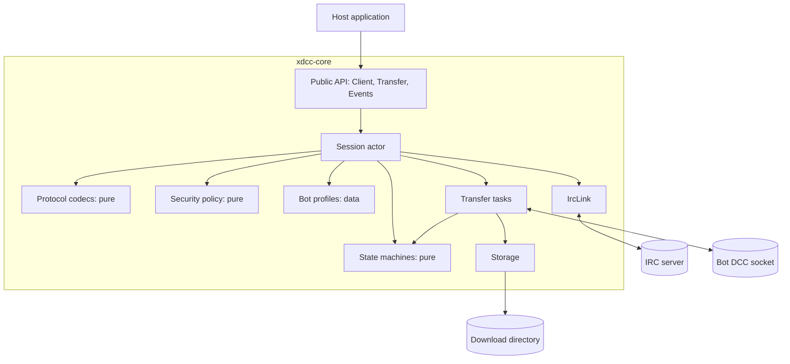
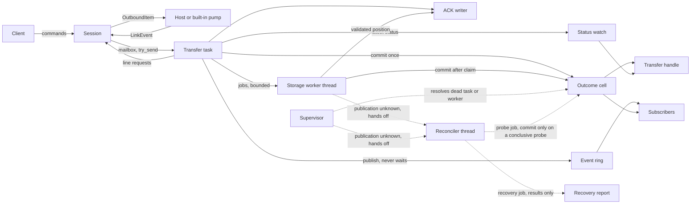
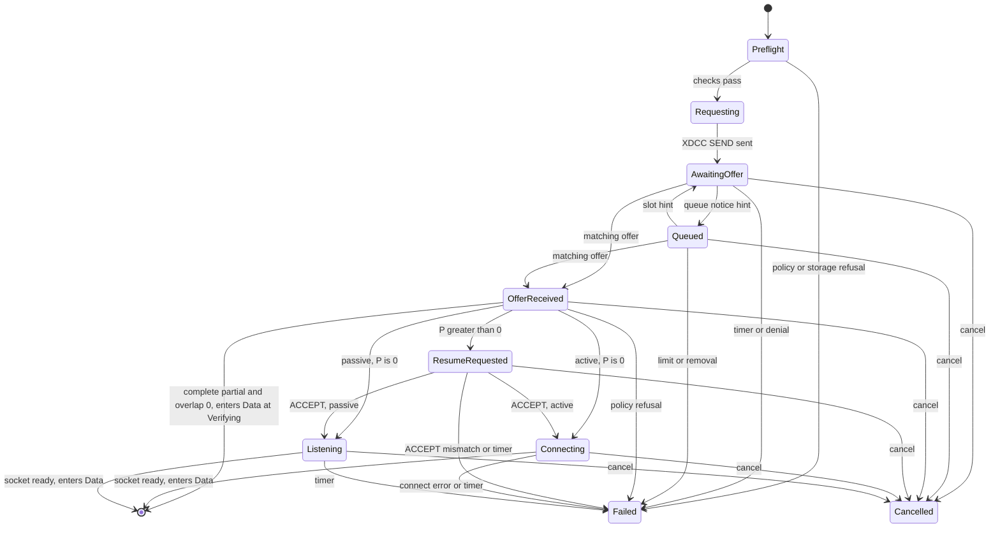
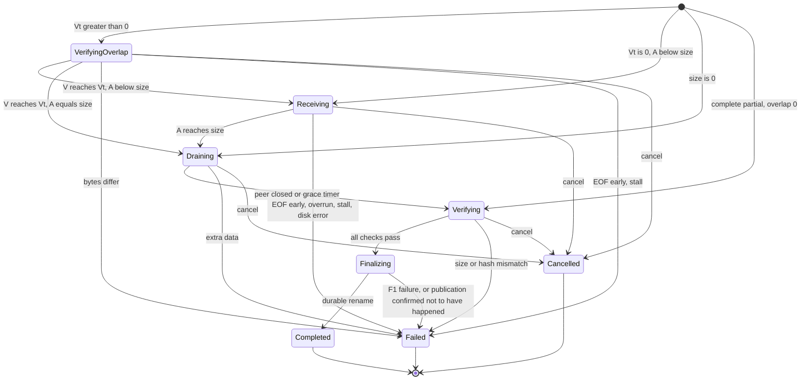

# XDCC Core Architecture

**Status:** Phase 0 draft, revised after independent review, 2026-10-31. Design only. All Rust below is illustrative, and none is implemented.

## 1. Purpose and principles

XDCC Core is a reusable Rust library that requests a pack from an XDCC bot, negotiates a DCC transfer, downloads the file safely, and resumes interrupted downloads.

1. **Never report false success.** Completion is proven locally.
2. **Untrusted input is parsed once at the edge,** into types that cannot represent invalid values.
3. **Protocol logic is pure.** Parsers and state machines do no I/O, which makes them testable, fuzzable, and deterministic.
4. **Evidence over folklore.** Compatibility behaviour is data in a profile, each value traceable to `PROTOCOL_SPEC.md`.
5. **Host-agnostic.** The library works with its own IRC client or inside an application that owns its connection.
6. **Keep the partial.** Failure never destroys downloaded data, unless the caller explicitly asks.

**Non-goals for v0.1:** sending files (being a bot), DCC CHAT, search across bots, a CLI, and a GUI.

## 2. System view



## 3. Crate structure

### Evaluated options

| Candidate split | Verdict | Reason |
|---|---|---|
| Separate protocol parsing crate | No | Same release cadence, no independent users yet. Feature flags give the same dependency isolation. |
| Separate IRC integration crate | No | `IrcLink` is a small channel pair in the main crate. The built-in client is feature-gated. |
| Separate DCC transfer crate | No | Tightly coupled to state machines and storage |
| Separate bot compatibility crate | No | Profiles are small data tables |
| Separate public API crate | No | A facade over one crate adds nothing |
| Test harness crate | **Yes** | Different dependencies, unpublished, and it must depend on the library's public API without cycles |
| Fuzz targets | **Yes**, as `cargo fuzz` convention | Requires nightly. Must stay out of the normal workspace. |

### Recommended layout

One published crate, one unpublished test crate. Extracting `proto` later is a non-breaking change if a real consumer appears.

```text
xdcc-core/
├── Cargo.toml            workspace root and the xdcc-core package
├── src/
│   ├── lib.rs
│   ├── proto/            IRC lines, CTCP, DCC, XDCC commands, notices
│   ├── policy/           NetPolicy, filename sanitiser, limits
│   ├── machine/          Negotiation and transfer state machines
│   ├── profile/          Compatibility profiles
│   ├── store/            Partial files, sidecars, finalisation
│   ├── net/              Connect, listen, ACK framing
│   ├── engine/           Session actor, transfer tasks, retry
│   ├── link/             IrcLink channel pair, epochs, built-in client
│   ├── event.rs
│   ├── error.rs
│   └── config.rs
├── crates/xdcc-sim/      publish = false. Fake IRC server and scriptable bot.
├── fuzz/                 cargo-fuzz targets, excluded from the workspace
├── tests/                Integration tests using xdcc-sim
└── docs/                 Includes docs/research/, reproducible evidence that is never built or shipped
```

### Features

| Feature | Default | Enables |
|---|---|---|
| `runtime` | yes | `engine`, `net`, `store`, `link` with Tokio |
| `irc-client` | yes | Built-in IRC client with TLS |
| `hash-md5` | no | Optional bot-supplied MD5 check |

With `default-features = false`, only `proto`, `policy`, `machine`, and `profile` remain. They have no I/O and no Tokio dependency.

## 4. Module responsibilities

| Module | Owns | Must not |
|---|---|---|
| `proto` | Bytes to typed messages and back | Do I/O, read clocks, or allocate unboundedly |
| `policy` | Decisions on addresses, names, limits | Touch sockets or files |
| `machine` | States, transitions, invariants. Takes events and returns actions. | Do I/O. Time is passed in. |
| `profile` | Compatibility values | Contain logic or weaken security |
| `store` | All filesystem access, via capability `Dir` | Interpret network input as paths |
| `net` | Sockets, ACK framing, listener lifetime | Decide policy. It receives an approved address type. |
| `engine` | Tasks, channels, timers, retry | Contain protocol parsing |
| `link` | IRC channel pair, epochs, built-in pump | Understand DCC |

`policy::ApprovedAddr` can be constructed only by `NetPolicy::check`, and `net::connect` takes that type. So SEC-2 is enforced by the compiler. `store::SafeName` works the same way for SEC-4.

## 5. Dependencies

Versions and data were read from crates.io on 2026-10-31.

### Runtime

| Crate | Version | License | Why |
|---|---|---|---|
| `tokio` | 1.54 | MIT | Standard async runtime. Timers, sockets, sync. |
| `tokio-util` | 0.7 | MIT | `CancellationToken` |
| `bytes` | 1.12 | MIT | Buffers |
| `futures-core` | 0.3 | MIT or Apache-2.0 | `Stream` trait in the public API |
| `thiserror` | 2.0 | MIT or Apache-2.0 | Error types |
| `tracing` | 0.1 | MIT | Structured diagnostics |
| `cap-std` | 4.0 | Apache-2.0 with LLVM exception, or Apache-2.0, or MIT | Capability-scoped directory access |
| `cap-fs-ext` | 4.0 | as above | No-follow and extended open options |
| `rustix` | 1.1 | as above | `renameat2` with `RENAME_NOREPLACE` |
| `socket2` | 0.6 | MIT or Apache-2.0 | Port-range binding, socket options |
| `ipnet` | 2.12 | MIT or Apache-2.0 | Allow and deny networks |
| `serde`, `serde_json` | 1.0 | MIT or Apache-2.0 | Sidecar format |
| `crc32fast` | 1.5 | MIT or Apache-2.0 | Filename CRC32 check |
| `sha2` | 0.11 | MIT or Apache-2.0 | Host-supplied SHA-256 |
| `md-5` | 0.11 | MIT or Apache-2.0 | Optional bot MD5 |

### Built-in IRC client

| Crate | Version | License | Why |
|---|---|---|---|
| `tokio-rustls`, `rustls` | 0.26, 0.23 | MIT or Apache-2.0 (and ISC) | Pure-Rust TLS |
| `rustls-platform-verifier` | 0.7 | MIT or Apache-2.0 | OS trust store |

### Test only

| Crate | Version | Why |
|---|---|---|
| `proptest` | 1.12 | Property tests |
| `stats_alloc` | 0.1 | Counts allocations safely, since tests forbid `unsafe`. M1 uses it for the 16 KiB check. |
| `libfuzzer-sys` | 0.4 | Fuzzing |
| `tempfile` | 3.27 | Isolated directories |

A crate for cross-platform file identity is evaluated at M5, for the publication probe and recovery rows in §7.10.

### Rejected

| Crate | Reason |
|---|---|
| `irc`, `irc-proto` 1.1.0 | Well-kept and MPL-2.0, last release 2025-03-24, repository active in 2026. But its line codec produces `String` frames through an encoding, and `Message` has no from-bytes constructor. Filenames must survive byte-exact for RESUME, including non-UTF-8. A byte parser is needed for fuzzing regardless. A host using this crate can still integrate through `IrcLink`, if it can supply raw bytes. |
| `winnow` | Grammar is small. Plain slice code is easier to audit and bound. |
| `hickory-resolver` | SEC-3 forbids resolving offer addresses. System resolution is enough for the IRC server. |
| `loom` | No custom lock-free code |
| `turmoil` | Reconsider if `xdcc-sim` fault injection proves insufficient |

## 6. Ownership and concurrency

### Ownership

| Thing | Owner | Shared how |
|---|---|---|
| IRC socket | Host, or the built-in pump | Never shared with the library |
| Library end of the link | Session actor, exclusively | Not shared |
| Host end of the link | Host. The two halves can move to different tasks. | Not shared |
| Pending requests table | Session actor only | Not shared |
| DCC socket | One transfer task | Never shared |
| Partial file, sidecar, advisory lock | One storage worker thread | Never shared. Requests arrive as jobs. If publication is left unknown, the reconciliation record takes over the handles and lock. A recovery job holds the lock of a partial that has no transfer, only while it runs. |
| Publication gate | `TransferShared`, atomic | Changed only by compare-and-swap |
| Publication ledger | Storage worker writes, others read. The reconciler writes it after a handoff. | Atomic stage value |
| Reconciliation records | One reconciler per `Client` | Handed over by the worker or supervisor, never shared afterwards |
| Recovery job queue | One reconciler per `Client` | At most one queued job per partial |
| Transfer state | The transfer's state machine | Published as snapshots |
| Terminal outcome | `TransferShared`, written once | `Arc`, read by handles and streams |
| Config | `Arc` | Immutable |

No lock is held across `.await`. There is no shared mutable protocol state.

### Tasks



- **Session actor:** one per IRC connection. Owns the library end of the link. Routes each line to a transfer, using nick and request state.
- **Transfer task:** one per transfer. Runs retries. Drives the state machine.
- **Storage worker:** one dedicated OS thread per transfer. It owns every file operation for that partial, and runs them one at a time. See "Storage worker and publication".
- **Supervisor:** awaits the transfer task and the storage worker. It commits only what the gate and ledger establish, and it never infers an outcome from an aborted task.
- **Reconciler:** at most one OS thread per `Client`, alive only while it has work. It runs two job types, one at a time, and the job type sets what is allowed, not the thread. See "Publication probe", "Reconciliation", and "Reconciler jobs".
- **ACK writer:** owns the socket's write half and reads a `watch` value. It always sends the newest position, and it can never stall the read path. Frame writes complete fully. This implements `PROTOCOL_SPEC.md` §10.
- **Back-pressure:** socket reads wait for space in the bounded job queue (depth 8), so a slow disk throttles TCP naturally. Observers exert no back-pressure on anything.
- **Limits:** a `Semaphore` caps concurrent transfers globally. A per-bot gate defaults to one.

**The session actor never awaits a transfer.** It delivers to each transfer's mailbox (depth 64) with `try_send`. On a full mailbox, a notice is dropped and counted. An offer or ACCEPT that cannot be delivered fails that attempt with `MailboxOverflow`, class `Resumable`. Per-nick rate limits run first, so a full mailbox needs a flood or a stuck transfer, and it affects only that transfer.

### Outcome, status, and events

Reporting has three separate surfaces, and **no transfer ever waits on a consumer**.

| Surface | Mechanism | Delivery | Can block the transfer |
|---|---|---|---|
| Terminal outcome | Write-once cell in `TransferShared` | Authoritative. Committed exactly once, retained. | Never |
| Status and progress | `tokio::sync::watch` | Latest value | Never |
| Observational events | `tokio::sync::broadcast`, 256-entry ring per transfer | Best effort. A slow subscriber lags. | Never |

| Rule | Behaviour |
|---|---|
| OE-1 Commit first | The transfer task commits the outcome to the cell before publishing `Finished`. `wait()` reads only the cell. |
| OE-2 Publishing never waits | `broadcast::Sender::send` is synchronous. Its error for "no receivers" is ignored. |
| OE-3 Overflow | The ring overwrites the oldest entry. The lagging subscriber's next item is `EventItem::Lagged { missed }`, and it stays subscribed. |
| OE-4 Terminal delivery | `Finished` is derived from the cell, not read from the ring. Each stream yields it exactly once, then ends, so a lagging subscriber can miss intermediate events but never the outcome. A transfer with no outcome yields no `Finished` (OE-14). |
| OE-5 No subscribers | Normal. Events are discarded. Progress, completion, cancellation, and cleanup are unaffected. |
| OE-6 Dropped subscribers | No effect on the transfer or on other subscribers. |
| OE-7 Multiple subscribers | Each has its own cursor. A slow one lags alone. `events()` can be called any number of times. |
| OE-8 Late subscribers | The stream begins with `EventItem::Snapshot(Status)`. If already terminal, it yields `Snapshot`, then `Finished`, then ends. Earlier events are not replayed. |
| OE-9 Cancellation | `cancel()` is synchronous and idempotent. It attempts the gate compare-and-swap, then sets a token, needs no channel capacity, and returns a `CancelDisposition`. |
| OE-10 Shutdown | `shutdown` waits up to a deadline, never on subscribers, and commits only what the gate and ledger establish. A transfer that cannot be resolved is listed in `ShutdownReport`, with no outcome committed (see "Shutdown"). |
| OE-11 Dropped handles | A dropped `Transfer` detaches. The transfer continues. |
| OE-12 Retention | The registry keeps the last 1,024 finished outcomes, then evicts the oldest (SEC-7). A held handle keeps its own `Arc`, so it stays valid. After eviction `client.transfer(id)` returns `None`. |
| OE-13 Decision points | `ResumePolicy::Ask` must not depend on a subscriber. The pending decision is visible in `Status`, and `decision_timeout` (default 300 s) ends the transfer with `ResumeDecisionTimeout`, partial kept. |
| OE-14 Unresolved transfers | An unknown publication is not an outcome, so nothing is committed and no `Finished` is produced. It is visible through `unresolved()`, `Status`, and `Event::PublicationUnresolved` (see "Reconciliation"). |

### IRC link contract

The earlier `IrcLink` trait took `&mut self` for both `send` and `recv`, so a pending `recv` blocked sending, and cancellation safety was undefined. It is replaced by a **pair of independent bounded channels**. Reading and writing cannot block each other by construction, and `Client` needs no generic parameter.

```rust
pub struct LinkEpoch(pub u64);          // host increments on each IRC connection

#[non_exhaustive]
pub enum LinkEvent {
    Ready { epoch: LinkEpoch, own_nick: Vec<u8>, casemapping: CaseMapping },
    Line { epoch: LinkEpoch, line: InboundLine },
    NickChanged { epoch: LinkEpoch, nick: Vec<u8> },
    Down { epoch: LinkEpoch, reason: LinkDownReason },
}

pub struct OutboundItem { pub epoch: LinkEpoch, pub line: OutboundLine, pub class: LineClass }

pub struct IrcLink { /* library end, consumed by the builder */ }
pub struct HostLink { pub inbound: InboundTx, pub outbound: OutboundRx }

impl IrcLink {
    pub fn channel(config: LinkConfig) -> (IrcLink, HostLink);
}
impl InboundTx {                         // Clone
    pub async fn deliver(&self, event: LinkEvent) -> Result<(), LinkClosed>;
    pub fn try_deliver(&self, event: LinkEvent) -> Result<(), TryDeliverError>;
}
impl OutboundRx {
    pub async fn recv(&mut self) -> Option<OutboundItem>;   // cancel-safe
}
```

| Topic | Contract |
|---|---|
| **Concurrency** | The directions are independent. A pending read never delays a write, and a full outbound queue never stops inbound draining. |
| **Ownership** | `Client` owns `IrcLink`. The host owns `InboundTx` and `OutboundRx`, and can run them in separate tasks. The built-in client is just another pump over the same pair. |
| **Line format** | Raw bytes with no CRLF. `InboundLine` refuses more than 8191 + 512 bytes. `OutboundLine` already refuses CR, LF, and NUL. |
| **Ordering** | FIFO within each direction. No ordering holds across directions. Lines are not reordered by class. |
| **Delivery** | At most once. Acceptance by a channel does not mean the server received the line. Lost lines surface as protocol timers, never as false state. |
| **Inbound back-pressure** | Depth 256. `deliver().await` waits for capacity. The session drains continuously, because it never awaits transfers or outbound capacity. |
| **Host that cannot wait** | `try_deliver` returns `Full`, and the line may be dropped. A dropped line is equivalent to a lost IRC message. |
| **Outbound back-pressure** | Depth 64. The session holds a bounded queue and uses `Sender::reserve` as one `select!` branch, enabled only when a line is waiting. |
| **Transfer line requests** | A transfer awaits line capacity inside `select!` with its cancel token and `line_send_timeout` (default 30 s). Timeout fails the attempt with `LinkStalled`, class `Resumable`. |
| **Best-effort lines** | `XDCC CANCEL` and `XDCC REMOVE` use `try_send`, and are dropped and counted if full. Cancellation never waits for the link. |
| **Pacing** | Flood control belongs to the pump. The built-in pump paces lines. An embedding host applies its own. |
| **Keepalive** | The pump answers PING. It is IRC transport, and the library does not depend on it. |

**Cancellation safety.**

| Operation | Guarantee |
|---|---|
| `OutboundRx::recv` | Wraps `mpsc::Receiver::recv`, documented as cancel safe. If another `select!` branch wins, no line was consumed. |
| Session inbound read | Same guarantee |
| Session outbound send | `reserve`, then send on the permit. Tokio documents that a cancelled `send` loses the message, and points to `reserve` to avoid that. A cancelled `reserve` loses only its place in the queue. |
| `deliver` | Not cancel safe for the event. Cancelling may drop that event, which counts as a lost message. |
| Pump socket write | The host holds the item until the write finishes. A write abandoned midway is a link failure, and it must report `Down`. |

**Epochs and disconnection.**

| Event | Behaviour |
|---|---|
| `Ready` with a new epoch | The session records nick and casemapping. `Ready` means registered and able to send. Channel membership is the pump's job, so a pump must join required channels first. |
| Item from an old epoch | The pump discards any `OutboundItem` whose epoch is not current, so a queued `XDCC SEND` cannot leak onto a later connection and double-request a pack. The session ignores stale inbound events. |
| `Down` | Attempts in `Negotiation` fail with `LinkLost`, class `Resumable`. Queued outbound lines are dropped. **Transfers in `Data` continue**, since DCC is a separate TCP connection. If a bot then closes the transfer, as iroffer can [I1], that appears as early EOF. |
| Retry after `Down` | Waits for the next `Ready`, within the retry budget |
| `InboundTx` all dropped | Treated as a permanent `Down`. New requests fail with `LinkClosed`. Active `Data` transfers finish. |
| `OutboundRx` dropped | The session treats it as permanent `Down`. |
| `Client` shut down | `recv` returns `None` after queued items. `deliver` returns `LinkClosed`. |

### Storage worker and publication

**Why a dedicated thread.** The earlier design assumed that aborting a task could stop publication, and primary documentation says otherwise.

| Fact | Source |
|---|---|
| Cancelling a `tokio::fs` future stops the waiting, and the blocking operation continues on the pool | [tokio::fs](https://docs.rs/tokio/latest/tokio/fs/index.html) |
| `abort` has no effect on a started `spawn_blocking` task, and it may stop one that has not started | [JoinHandle](https://docs.rs/tokio/latest/tokio/task/struct.JoinHandle.html) |
| A queued blocking task may be cancelled at runtime shutdown, without any guarantee either way | [spawn_blocking](https://docs.rs/tokio/latest/tokio/task/fn.spawn_blocking.html) |
| Dropping a runtime waits forever for started blocking work. `shutdown_timeout` stops waiting and leaks it. | [Runtime](https://docs.rs/tokio/latest/tokio/runtime/struct.Runtime.html) |
| Long-lived blocking work should use a dedicated thread | [spawn_blocking](https://docs.rs/tokio/latest/tokio/task/fn.spawn_blocking.html) |
| A `tokio::fs::File` may not close when dropped if operations are in flight | [tokio::fs::File](https://docs.rs/tokio/latest/tokio/fs/struct.File.html) |
| When the main thread ends, the program ends, and other threads stop without running destructors | [std::thread](https://doc.rust-lang.org/std/thread/index.html) |

So an aborted task tells you nothing about a filesystem operation. Its result can be learned only from whatever owns that operation.

**Design.** Each transfer has one storage worker, a `std::thread` created at `Preflight`. The transfer semaphore bounds how many exist. It uses `cap-std` and `std::fs` directly, and `tokio::fs` is not used for partials.

| Property | Behaviour |
|---|---|
| Jobs | `Open`, `Chunk`, `Checkpoint(trigger)`, `Verify`, `Finalize`, `Discard`, `Close`. Run strictly in order. |
| State owned | File handles, advisory lock, sidecar, `V`, `W`, `D`, poison flag |
| Task abort | Dropping the job sender cannot interrupt a running job. The worker finishes the queue, runs `Checkpoint(Failure)`, releases the lock, and exits. |
| Runtime drop | The worker is not a Tokio task, so it cannot hold up runtime shutdown |
| Process exit | Stops the worker at an arbitrary point. This is a process crash, and §7.9 and §7.10 recovery applies. |
| A second transfer on the partial | Refused while the lock is held, as `Held(Busy)` |

**The publication gate** is the single point that decides whether a transfer can still be cancelled.

| Gate value | Meaning |
|---|---|
| `Open` | Nothing is committed to publication. Cancellation is possible. |
| `Closed { discard }` | Publication can never happen for this transfer |
| `Claimed` | The worker owns the outcome. Cancellation is too late. |

Only two transitions exist, both atomic compare-and-swaps from `Open`.

- `Open → Closed`: by `cancel()`, shutdown, or any path committing a non-publication outcome.
- `Open → Claimed`: by the worker, as the **first action of the `Finalize` job**.

A queued `Finalize` that loses to `cancel()` does nothing. Claiming inside the job means a gate can never say `Claimed` for work that never started.

**The ledger** records how far publication went. The worker writes it, or the reconciler once a record has been handed over, and each stage is stored **before** its operation begins, or after it returns where stated.

| Stage | Stored | Knowledge |
|---|---|---|
| `Claimed` | At claim | Publication committed. Nothing changed on disk yet. |
| `IntentDurable` | After F1 returns | Recovery would publish |
| `PublishInFlight` | Before F2 starts | The file may or may not be published. **Only the worker or a probe can know.** |
| `PublishUnknown` | After a probe returns `Indeterminate` and the record is handed over | F2 has ended, and its effect is not known |
| `Published` | After F2 returns success, or after a probe returns `Same` | The file is at its final name |
| `Cleaned` | After F5 returns | Nothing is left to do |

**Who may commit.** All commits go through one first-writer-wins operation, so INV-6 holds whichever path runs first.

| Gate | Situation | Committer | Outcome |
|---|---|---|---|
| `Open` | Pre-publication failure | Transfer task, after closing the gate | `Failed` |
| `Closed` | Cancelled | Transfer task, or the supervisor if the task is gone | `Cancelled`, or `Failed` for an earlier failure |
| `Claimed` | Normal | Storage worker, only | `Completed`, or `Failed` from F1 or a conclusive F2 result |
| `Claimed` | Worker died, ledger settles it | Supervisor, with no filesystem access | See "After the worker exits" |
| `Claimed` | Publication unknown, worker gone | Reconciler, only on a conclusive probe | See "Reconciliation" |
| `Claimed` | Deadline passed, ledger at `Published` or later | Shutdown | `Completed`, with conservative fields |
| `Claimed` | Deadline passed, ledger below `Published` | **Nobody** | Listed as unresolved |

**Supervisor algorithm.**

1. Await the transfer task. `Ok`, panic, and cancelled are all possible, and tokio documents that an aborted task may still report completion. The result alone decides nothing.
2. If the outcome is committed, go to step 5.
3. Attempt `Open → Closed`. If the gate is `Closed`, commit `Failed(Internal)` when the task panicked, otherwise `Cancelled`.
4. If the gate is `Claimed`, commit nothing, and wait for the worker.
5. Await the worker's exit signal, sent by a drop guard so it also fires on unwind. If it ended uncommitted, apply "After the worker exits".

**After the worker exits.** The ledger is read first, because it is evidence that does not depend on the filesystem still being readable.

| Ledger | What it proves | Action |
|---|---|---|
| `Claimed`, `IntentDurable` | F2 never started | Commit `Failed(Internal)`, with `intent_persisted` for `IntentDurable`. No probe. |
| `PublishInFlight` | F2 may have acted. A panic means it is no longer running. | Hand the record to the reconciler for an immediate probe |
| `PublishUnknown` | The worker already handed the record over | Nothing |
| `Published`, `Cleaned` | The file reached its final name | Commit `Completed { publication: NameUnconfirmed, cleanup_pending: true }`. No probe. |

### Publication probe

One classification, used by the worker, the reconciler, and startup recovery. It compares names against the file's identity, using no-follow lookups relative to the open directory handle. Identity is the device and inode recorded at open, or volume and file index on Windows. After a restart it is the sidecar's `file_id`.

**A failed inspection is never evidence about publication.** `ENOENT`, or its platform equivalent, is the only lookup error that means a name is absent. Every other error, such as `EIO`, `ESTALE`, `EACCES`, or a timeout, is a failed lookup. So is a platform that cannot return a stable identity.

| Lookup of `N` | Lookup of `P` | Result | Meaning |
|---|---|---|---|
| Same identity | Anything, including failed | `Same` | Publication confirmed |
| Absent | Same identity | `Absent` | Confirmed not published, under FA-1 and FA-2 |
| Different file | Same identity | `Different` | Something else owns `N`, and the file is still at `P` |
| Failed | Anything | `Indeterminate` | `N` could not be inspected |
| Absent or different file | Failed, absent, or another file | `Indeterminate` | The file is at neither name, so the probe cannot say what happened to it |

`Absent` and `Different` are one conclusive class, "not published at `N`", and differ only in the policy applied. They need `P` to be confirmed, because publication could have moved the file.

The probe rests on two filesystem assumptions, stated in §7.10 as FA-1 and FA-2.

### Reconciliation

An `Indeterminate` result is not retried in place, and it does not end the transfer. Nothing is committed, and responsibility passes as follows.

| Situation | Responsible | What keeps the state |
|---|---|---|
| Worker running, including a stuck F2 or a stuck probe of its own | Storage worker | Its handles and lock |
| Worker gone, publication unknown, `Client` running | The `Client`'s reconciler | Reconciliation record |
| `Client` shut down, or the process exited | Startup recovery in the next `Client` | The `finalizing` sidecar on disk. Nothing in memory. |

**The record** holds the partial handle, directory handle, advisory lock, identity, ledger, and transfer slot. These sit in `TransferShared`, so they survive a worker panic. Keeping them open matters. The lock makes any new request on this partial `Held(Busy)`, and the open handle stops the inode being reused, so identity stays meaningful.

| Bound | Rule |
|---|---|
| Threads | One reconciler per `Client`. It starts with the first job, and exits when no record is armed and no recovery job is queued. A second is never started, even if a job hangs. |
| Concurrency | One job at a time. Armed records go in turn, and before any recovery job, because a transfer is waiting on them. |
| Schedule | Records from the supervisor are probed at once. Others wait the first delay. Delays start at 5 s and double to a 5 min cap. |
| Budget | 8 attempts per record, about 10 minutes. The record then goes dormant, and keeps everything it holds. |
| Re-arming | `Client::reconcile_unresolved()` is synchronous, idempotent, and does not wait for the work. It gives each dormant record one more attempt, and repeated calls before that attempt runs have no further effect. It also queues recovery jobs (see "Reconciler jobs"). |
| Records | Each keeps its transfer slot, so the transfer limit bounds them. Dormant records reduce capacity until they resolve or the `Client` restarts. |

A job that never returns stalls this thread, and the others wait for it. They stay unresolved, which is true. That is the price of a fixed thread count.

**A probe job only inspects and commits.** It never runs F2 to F5, never deletes, and never applies a conflict policy.

| Probe result | Commit | Then |
|---|---|---|
| `Same` | `Completed { publication: NameUnconfirmed, cleanup_pending: true }` | Lock and slot released. Recovery does the cleanup. |
| `Absent` | `Failed(Storage)`, or `Failed(Internal)` after a worker panic, with `intent_persisted` | Lock and slot released. Recovery row 1 may publish, under D18. |
| `Different` | `Failed(FinalExists)` | Lock and slot released. Recovery row 4 holds the partial. |
| `Indeterminate` | Nothing | Next attempt, or dormant |

**While publication is unknown.**

| Surface | Behaviour |
|---|---|
| `wait()` | Stays pending. It resolves only if a worker or reconciler commits. It is cancel-safe, so a host bounds it with a timeout. |
| `outcome()` | `None` |
| `unresolved()` | `Some(UnresolvedTransfer)`, with the owner, cause, and attempts so far |
| `Status` | `state: PublicState::PublicationUnknown` |
| Events | `Event::PublicationUnresolved` on entry and whenever the owner changes. No `Finished`. |
| Stream end | Open while the worker or reconciler owns the transfer. When the owner becomes `NextStartup`, the stream delivers that event and ends, with no `Finished`. |
| `cancel()`, `cancel_and_discard()` | `TooLate`. Nothing is deleted. |
| New request, or `resume` for the partial | `Held(Busy)` while the record holds the lock |
| `ResumeDecision::RestartFromZero` | Refused for the same reason |
| Retry engine | Does not run, because only a terminal `Failed` can be retried |

A dormant record leaves `wait()` pending with nothing scheduled. So does an owner of `NextStartup`, and in that case nothing in this process can resolve it. Hosts use `unresolved()` or the shutdown report to stop waiting.

### Reconciler jobs

The reconciler thread only executes work. **What a job may do comes from its type, never from the thread it runs on.** There are two types.

| | Probe job | Recovery job |
|---|---|---|
| Subject | A claimed transfer in this process with no outcome | A partial left at §7.10 row 6 or 7 by an earlier recovery, with no transfer in this process |
| Created by | Handoff, the schedule, or a re-arm | `reconcile_unresolved()`, one per such partial. A partial with a record never gets one. |
| State owner | The record, `ResolutionOwner::Reconciler` | No `ResolutionOwner`, since no transfer exists. The `finalizing` sidecar on disk is the state, and between jobs nothing is held in memory but the report. |
| Lock | Already held by the record. Released only by a conclusive commit, or at shutdown. | Taken without blocking when the job starts, and released when it ends. If it is busy, the job changes nothing, records the skip, and the partial stays eligible. |
| Transfer slot | Held by the record | None |
| Evidence | The publication probe | Lookups made in this job, after taking the lock. A result from an earlier job or pass is never reused. |
| May change | The ledger and the transfer's outcome | Only what §7.10 rows 1 to 3 direct, plus the held status and report |
| Never | Run F2 to F5, clean up, delete, write the sidecar, apply a conflict policy | Commit an outcome, touch a record, apply a conflict policy, discard a partial |
| Result visible in | `wait()`, `outcome()`, `unresolved()`, events | `recovery_report()` and `partials()` |
| Retry bound | 8 attempts, then one per re-arm | None automatic: no schedule and no budget. At most one queued job per partial, however often the host calls. |
| At shutdown | One more attempt, then the record closes | Queued jobs are dropped, and a running job stops at its next stop check |

**A recovery job runs in this order.**

1. Try the lock.
2. Read the sidecar, look up `P` and `N`, and choose the §7.10 row.
3. For rows 4 to 7, update the held status and the report, and change no file.
4. For rows 1 to 3, do what the row directs. A stop check comes before F2, F3, F4, and F5, and during a digest check. After stop is set, no further step begins.
5. Release the lock. Any failed check, lookup, or step ends the job there, with no retry inside it.

Every point where a job can stop is a state recovery already handles, so a stopped job is equivalent to a crash at that step.

**`Indeterminate` authorises nothing, in either job type.** It never changes a file name, the partial, or the sidecar, at any step. In a probe job the record stays open. In a recovery job the partial is row 6. An earlier conclusive observation in the same job does not outlive it: if a repeated F2 ends `Indeterminate`, the job stops before F3, and no cleanup follows.

A long job delays others, without making anything false. A row 1 digest check of a large file holds this thread for its whole length, and queued jobs wait.

### Cancellation

A `CancellationToken` tree: client root, then one child per transfer. The gate decides the outcome, and the token only stops work.

| When `cancel()` runs | Gate result | `CancelDisposition` | Outcome |
|---|---|---|---|
| Any time before `Finalize` starts, including during `Verifying` | `Closed` | `Accepted` | `Cancelled`, partial kept. A running storage job finishes first, and cannot be interrupted. |
| `Finalize` queued, not started | `Closed` | `Accepted` | `Cancelled`. The job sees the closed gate and does nothing. |
| After claim, before F2 | `Claimed` | `TooLate` | Publication continues. `Completed`, or `Failed` from F1 or a conclusive F2 result. |
| During F2 | `Claimed` | `TooLate` | As above. The operation cannot be recalled. |
| After F2 | `Claimed` | `TooLate` | `Completed` |
| Publication unknown | `Claimed` | `TooLate` | None yet. See "Reconciliation". |
| After the outcome is committed | n/a | `AlreadyFinished` | Unchanged |

| Trigger | Behaviour |
|---|---|
| `cancel()` accepted | Stop reading. Run `Checkpoint(Cancel)`. Send best-effort `XDCC CANCEL`, or `XDCC REMOVE` when queued. Keep the partial. Commit `Cancelled`. |
| `cancel_and_discard()` accepted | As above, then a `Discard` job deletes partial and sidecar. It runs only after the gate is `Closed`, so it can never race publication, and it only deletes files this transfer created. It is never applied after `TooLate`. |
| `shutdown(Graceful)` | See below |
| Process death | Sidecars and partial files allow a later resume (§7.9, §7.10) |

All `select!` branches in the transfer task are cancel-safe. A chunk handed to the worker is recorded in the §7.6 counters, or fails the transfer.

### Shutdown

1. Stop new requests.
2. For each transfer, attempt the same gate change as `cancel()`.
3. Wait for transfers to resolve, up to `shutdown_deadline` (default 30 s). Subscribers are never waited on.
4. Set the reconciler's stop flag for recovery jobs. Queued ones are dropped, and no new one is accepted. Before the deadline, the reconciler gives every record, dormant ones included, one more attempt, within the time left.
5. At the deadline, abort remaining transfer tasks. The supervisor commits `Cancelled` for closed gates. A worker still running a job keeps running, and is listed in `storage_busy`.
6. Stop the reconciler. Every record still open is closed, which releases its handles, lock, and slot, and its owner becomes `NextStartup`. A probe still running is abandoned, and its result is discarded when it returns. A recovery job still running is listed in `recovery_busy`. It keeps its partial's lock until it reaches its next stop check, and takes no further step. Its result is not reported, and the next recovery establishes the state from the disk.
7. For each claimed transfer with no outcome, read the ledger.

| Ledger at deadline | Action | Why |
|---|---|---|
| `Published` or `Cleaned` | Commit `Completed`, with `publication: NameUnconfirmed`, `cleanup_pending: true` | Publication is known. Fields may understate, and the worker's later commit is ignored. |
| `Claimed`, `IntentDurable`, `PublishInFlight` | Commit nothing, and add to `unresolved`, owner `Worker` | The true result is unknown, and any terminal value could be false |
| `PublishInFlight` or `PublishUnknown`, with the worker gone | Commit nothing, and add to `unresolved`, owner `NextStartup` | As above, and a failed inspection is not evidence |

```rust
pub struct ShutdownReport {
    pub finished: usize,
    pub unresolved: Vec<UnresolvedTransfer>,   // no outcome committed
    pub storage_busy: Vec<TransferId>,         // Cancelled, but a job is still running
    pub recovery_busy: Vec<PartialId>,         // a recovery job has not reached a stop check
}

pub struct UnresolvedTransfer {
    pub id: TransferId,
    pub stage: PublicationStage,
    pub final_name: SafeName,
    pub owner: ResolutionOwner,
    pub cause: UnresolvedCause,
    pub attempts: u32,
}

#[non_exhaustive]
pub enum ResolutionOwner { Worker, Reconciler, NextStartup }

#[non_exhaustive]
pub enum UnresolvedCause {
    OperationRunning,           // the worker has not returned from F1 or F2
    LookupFailed,               // a name could not be inspected
    IdentityUnavailable,        // the filesystem gives no stable identity
    FileAtNeitherName,          // the file is at neither name
}
```

**Unresolved is a report, not a terminal state.** For a running worker, no probe runs, since the answer could change a moment later, and a probe of the same directory can hang the same way.

| What happens next | Result |
|---|---|
| The worker finishes while the process lives | It commits normally, even after `shutdown` returned, if its result is conclusive. Held handles see it. Exactly once holds. |
| The worker's probe is `Indeterminate` after `shutdown` | No reconciler remains. The worker closes the record, and the owner becomes `NextStartup`. Nothing is committed. |
| The process exits first | No outcome in this process. Startup recovery establishes the state from the disk. |
| The operation never returns | `wait()` stays pending, and `outcome()` stays `None`. Nothing in user space can resolve a stuck kernel operation. Hosts bound the wait with a timeout, which is safe because `wait()` is cancel-safe. Streams stay open. |
| The operation returned, and publication could not be established | `wait()` stays pending, and `outcome()` stays `None`, as in "Reconciliation". Streams end when the owner becomes `NextStartup`. |

So `wait()` can stay pending in two cases: a storage operation that never returns, and a publication that nothing has yet been able to establish, including after the operation returned an error. Exiting with unresolved transfers is safe, and it counts as a process crash for storage.

### Error propagation

```mermaid
flowchart TB
    Parse[ParseError] -- counted and logged, no state change --> Session
    Policy[PolicyError] --> Reject[Offer rejected, event emitted]
    Io[io::Error] --> Class[Classified]
    Class --> TE[TransferError]
    TE --> Retry{RetryClass}
    Retry -- Resumable --> Backoff[Backoff and retry]
    Retry -- Never --> Failed[Terminal Failed]
    SE[LinkEvent::Down] -- negotiating attempts fail --> TE
```



Rules:

1. A parse failure never affects a transfer or a session.
2. No panics from network input. `unwrap` and `expect` are denied by Clippy in non-test code.
3. Each error type has a `kind()`, so hosts need not match strings.
4. `io::Error` is wrapped with context: operation and role.

## 7. State machines

Implemented as `enum` state plus a pure function:

```rust
fn step(state: State, input: Input, now: Instant, ctx: &Ctx) -> (State, Vec<Action>);
```

`Input` covers parsed IRC events, socket and disk results, timers, and cancel. `Action` covers send a line, connect, listen, open a partial, set a timer, emit an event. The engine executes actions. Property tests can run the machine with no sockets at all.

### 7.1 Overview

Two machines are chained. `Negotiation` runs on the IRC side until a socket is ready. `Data` runs after that. A retry returns from `Data` to `Negotiation` with a new attempt number.

### 7.2 Negotiation machine



`P` is defined in §7.6. A complete partial with overlap disabled skips the network and sends best-effort `XDCC CANCEL`. `LinkEvent::Down` fails any non-terminal negotiation state with `LinkLost`.

| State | Valid inputs | Invalid inputs, ignored and counted |
|---|---|---|
| `AwaitingOffer` | Matching offer, notices, timer, cancel, link lost | ACCEPT, offer from another nick |
| `Queued` | As above | ACCEPT |
| `OfferReceived` | Internal policy result | Second offer is held, identical offers are dropped |
| `ResumeRequested` | ACCEPT, identical re-offer, timer, cancel | Mismatched ACCEPT is terminal for this attempt. New offer with different size fails the attempt. |
| `Connecting`, `Listening` | Socket result, timer, cancel | Offers |

An identical duplicate offer is a no-op in every state, since iroffer can retransmit [I1]. A duplicate with changed size, address, or port fails the attempt with `OfferChanged`, because resume state would otherwise be ambiguous.

### 7.3 Data machine



| Transition | Forbidden because |
|---|---|
| Anything → `Completed`, except from `Finalizing` | Only one path proves success |
| `Receiving` → `Verifying` directly | Must pass through `Draining` to detect overrun |
| `VerifyingOverlap` → `Failed` after writing | Overlap never writes, so a mismatch leaves the partial untouched |
| `Finalizing` → `Failed` after publication | The file is published. Later failures are reported on `Completed` (§7.10). |
| `Finalizing` → `Cancelled` | `Finalizing` begins at the gate claim, after which cancellation is too late |
| `Finalizing` → any terminal state on `Indeterminate` | A failed inspection establishes nothing. The transfer stays non-terminal, shown as `PublicationUnknown` (§6). |
| `Failed` or `Cancelled` → any | Terminal. A retry is a new attempt, not a state revival. |
| `Queued` → `Receiving` | Every connection requires an approved offer |
| Any state on a notice → `Completed` | Notices are untrusted |
| Any state on EOF alone → `Completed` | EOF proves nothing |

### 7.4 Terminal states

| State | Meaning | Partial |
|---|---|---|
| `Completed { integrity, publication }` | File is at its final name, with structural checks passed | Removed, the sidecar too, unless cleanup is pending |
| `Failed { kind, retry }` | Attempts exhausted, or non-retryable | Kept |
| `Cancelled` | The gate closed before claim, so nothing was published | Kept, or discarded on request |

`allow_unknown_size` adds a fourth outcome, `EndedUnverified`, which is deliberately not `Completed`. The file stays at its partial name.

`PublicationUnknown` is not a terminal state and has no entry here (§6).

### 7.5 How a false "complete" is prevented

`Completed` requires **all** of the following, evaluated locally in this order. Symbols are defined in §7.6.

1. `Z` (the offered size) is known, and fixed on entry to `Data`.
2. `P + V + W == Z`, so the whole range is accounted for.
3. `V == Vt`, so the overlap was verified in full.
4. `R == V + W`, so no received byte is unaccounted for.
5. Nothing beyond `Z` was accepted. Excess bytes were read into a bounded buffer, discarded, and failed the transfer.
6. Every write was checked, and short writes were looped.
7. `sync_all` returned success (F0 in §7.10).
8. `fstat(partial).len == Z` on the open handle.
9. Any requested digest matches. A host-required digest that cannot be computed is a failure.
10. No-replace publication succeeded, or a probe returned `Same` (F2 in §7.10).

Directory sync is not a precondition. Its result is reported as `publication`, because once the name is visible, failing the transfer would be false, and a retry would hit `FinalExists`.

For the same reason, `Cancelled` is committed only after the gate closed, and `Failed` is committed only when the file is known not to be published.

These signals never contribute: bot notices, `Transfer Completed` text, EOF, ACK counts, and elapsed time.

**What `Completed` means.** There are three distinct levels, and they must not be blurred.

| Level | Guarantee | Applies to |
|---|---|---|
| **Structural completion** | The published file has exactly `Z` bytes, every byte was received in order on this protocol's accounting, nothing was overwritten, and no partial was published. | Every `Completed` |
| **Content integrity against a trusted digest** | The file's bytes match a SHA-256 that the host obtained from a source it trusts. | Only `IntegrityLevel::Sha256HostSupplied` |
| **Corruption check from an untrusted source** | Bot MD5 or a CRC32 in the filename matched. This detects accidental corruption, and a malicious sender can supply a matching value. | `Md5BotSupplied`, `Crc32Filename` |

**Undetectable under `SizeOnly`.** Without a digest, these end as `Completed { integrity: SizeOnly }`, by design and without any error:

- Same-length corruption anywhere in the data.
- Same-length substitution of the file by the sender or a network attacker.
- Changed content outside the resume overlap.

No test may require otherwise. See `DEVELOPMENT_PLAN.md` §4.

**Hash on resume.** Hashing covers the whole file during `Verifying`, reading from disk. An incremental hash state is not relied on, since a resumed transfer has no state for the earlier bytes. For large files this is a meaningful cost, and only runs when a hash exists.

**Sequence at the end.**

1. `A` reaches `Z`, through a write or through overlap verification.
2. Final ACK is sent. It reports receipt, and it does not assert durability. The bot waits on it, and its timer should not run through a slow `fsync`.
3. Read until EOF or grace timer. Any further byte fails with `Overrun`.
4. `Verifying`, then `Finalizing`.

If the machine dies between steps, §7.9 and §7.10 define recovery.

### 7.6 Transfer accounting and invariants

The earlier single `received` and `written` counters could not describe overlap, since overlap bytes are received but never written. These symbols replace them. `research/accounting_check.py` runs the equations.

| Symbol | Name | Scope | Meaning |
|---|---|---|---|
| `Z` | `size` | Transfer | Offered size |
| `L` | `file_len` | Attempt start | Length of the partial on disk |
| `D` | `durable_pos` | Persistent | Position covered by the last completed checkpoint |
| `O` | `overlap_limit` | Config | Maximum overlap, default 64 KiB |
| `E` | `trusted_len` | Attempt | Existing bytes treated as valid. `E = min(L, D)`. |
| `Vt` | `overlap_target` | Attempt | `Vt = min(O, E)` |
| `P` | `request_pos` | Attempt | Where the sender starts. `P = E - Vt`. |
| `R` | `rx_bytes` | Attempt | Bytes read from the socket and accepted this attempt |
| `V` | `overlap_verified` | Attempt | Existing bytes confirmed by comparison, `0 <= V <= Vt` |
| `W` | `new_written` | Attempt | Bytes newly written to the file this attempt |
| `A` | `validated_pos` | Attempt | Absolute position validated locally. `A = P + V + W`. |

**Equations.** These hold whenever no chunk is mid-processing.

| ID | Equation | Meaning |
|---|---|---|
| AC-1 | `R == V + W` | Every byte was verified or written |
| AC-2 | `W > 0` implies `V == Vt` | Nothing is written before the overlap passes |
| AC-3 | `P + R <= Z` | Overrun is refused before any accounting |
| AC-4 | `A == P + R` | Position follows the stream |
| AC-5 | `L_now == E + W` once `W > 0` | New data follows the trusted prefix directly |
| AC-6 | `D <= Z`, and `D` never decreases | Checkpoints only move forward |
| AC-7 | `D` changes only through checkpoint rule CE in §7.9, to a value `T > D` or, at finalisation, `T == Z` | Periodic, cancel, and failure callers share one rule |
| AC-8 | While `V < Vt`, `A < E == D`, so no position may be recorded | Overlap can never move `D` |

**Processing a chunk.** A chunk can straddle the overlap boundary, so it is split: the first `Vt - V` bytes are compared with the file at `P + V`, and the rest are written at `E + W`. A compare failure stops processing, leaving `V` unchanged.

**The untrusted tail.** Bytes beyond `E` are not discarded at startup. The file is truncated to `E` immediately before the first new write of an attempt. If negotiation fails or the overlap mismatches, the partial stays byte-identical. mIRC adopted the same timing in v6.11 [V2].

**ACK eligibility.**

| ID | Rule |
|---|---|
| AK-1 | The ACK value is always `A` |
| AK-2 | Eligible only when `A > P`, so never before the first byte of the attempt is verified or written |
| AK-3 | Values strictly increase within an attempt |
| AK-4 | Bytes that fail comparison never contribute to an ACK |
| AK-5 | ACKs depend on `A`, not `D`. They report receipt and promise no durability. |
| AK-6 | Width follows `AckPolicy`. The value is unaffected. |

**Progress.** Public `Progress.position` is `max(E, A)`, which never moves backwards during overlap, and the bytes-per-second figure counts `W` only. Re-downloaded overlap is not new progress.

**Completion.** See §7.5. In these symbols, `A == Z`, `V == Vt`, and `R == V + W`, with `L_now == Z` by `fstat`.

**Retries.** Each attempt recomputes `E`, `Vt`, and `P` from `L` and `D`, and resets `R`, `V`, and `W`. `D` persists. The retry budget's progress check uses `W`, so a sender that repeatedly delivers only the overlap makes no progress.

**Overlap mismatch.** Terminal `ResumeMismatch`, class `Never`, with `W == 0`, no ACK for the differing chunk, no truncation, and `D` unchanged.

**Edge cases.** Rows come from `research/accounting_check.py`, with `O = 64`.

| Case | `Z` | `L` | `D` | `P` | `Vt` | `W` | RESUME | Notes |
|---|---|---|---|---|---|---|---|---|
| Fresh | 1000 | 0 | 0 | 0 | 0 | 1000 | No | |
| Normal resume | 1000 | 400 | 400 | 336 | 64 | 600 | Yes | |
| Untrusted tail | 1000 | 500 | 400 | 336 | 64 | 600 | Yes | 100 tail bytes cut at first write |
| Partial smaller than overlap | 1000 | 40 | 40 | 0 | 40 | 960 | No | Fresh connection, verifying 40 bytes |
| Partial equal to overlap | 1000 | 64 | 64 | 0 | 64 | 936 | No | |
| Complete partial, overlap on | 1000 | 1000 | 1000 | 936 | 64 | 0 | Yes | `W = 0`, completes on `V` alone |
| Complete partial, overlap off | 1000 | 1000 | 1000 | 1000 | 0 | 0 | No | No network, best-effort `XDCC CANCEL` |
| Overlap off | 1000 | 400 | 400 | 400 | 0 | 600 | Yes | |
| Zero-length file | 0 | 0 | 0 | 0 | 0 | 0 | No | No ACK, drain, publish empty file |

`L > Z`, or `L < D`, never reaches negotiation (§7.9).

### 7.6.1 Invariants

| ID | Invariant |
|---|---|
| INV-1 | `R`, `V`, `W`, and `A` are monotonic within an attempt |
| INV-2 | AC-1 to AC-8 hold whenever no chunk is mid-processing |
| INV-3 | ACK value `<= A <= Z` |
| INV-4 | No ACK while `A == P` |
| INV-5 | `Completed` is reachable only through §7.5 |
| INV-6 | The terminal outcome is committed exactly once, before `Finished` is published |
| INV-7 | At most one socket per transfer per attempt |
| INV-8 | A partial is opened by at most one transfer |
| INV-9 | The sidecar's `durable_offset` never exceeds the partial's synced length |
| INV-10 | `E <= D` in every attempt |
| INV-11 | `Z`, `wire_name`, port, and token are immutable within an attempt |
| INV-12 | Terminal states have no outgoing transitions |
| INV-13 | No transfer task awaits an observer |
| INV-14 | A final name appears only after F0, the gate claim, and F1 in §7.10 |
| INV-15 | The gate leaves `Open` at most once, and never changes afterwards |
| INV-16 | `Cancelled` implies the gate is `Closed`, and the worker never performed F1 or later |
| INV-17 | `Completed` implies F2 returned success or a probe returned `Same`. After a claim, `Failed` needs positive evidence: a ledger below `PublishInFlight`, or a probe result of `Absent` or `Different`. |
| INV-18 | No filesystem operation for a partial runs outside its storage worker, except a probe job or a recovery pass (§7.10) |
| INV-19 | After a sync failure, the poison flag stays set and `D` does not change for that worker's lifetime |
| INV-20 | `Indeterminate` never commits an outcome, and never leads to a publish, cleanup, or delete, in any job or recovery pass |
| INV-21 | A claimed transfer with no outcome always has one owner: worker, reconciler, or next startup |
| INV-22 | A `Client` has at most one reconciler thread running one job. Each record has a bounded number of attempts between host actions, and each partial at most one queued recovery job. |
| INV-23 | A probe job changes no file name, partial, or sidecar. A recovery job changes one only under the partial's lock, on lookups made in that job, as §7.10 rows 1 to 3 direct. |

### 7.7 Timers

| Timer | Default | Basis |
|---|---|---|
| Offer wait | 60 s | Client choice |
| Queue wait | 6 h, configurable, can be none | Client choice |
| RESUME to ACCEPT | 30 s | Well inside iroffer's 180 s limit |
| TCP connect | 20 s | Client choice |
| Passive listen | 60 s | Client choice |
| Stall, no bytes | 120 s | Below iroffer's 180 s no-contact limit |
| Drain grace | 10 s | Client choice |
| ACK interval | 1 s or 1 MiB, or after read batch | Client choice |
| Checkpoint | 30 s or 256 MiB of `W` | Trades durability against `fsync` cost. Overlap bytes never count. |
| Shutdown deadline | 30 s | Client choice |
| Reconciliation | 5 s, doubling to 5 min, 8 attempts | Long enough for a brief outage, then quiet until a host asks (§6). Probe jobs only. Recovery jobs have no timer. |

### 7.8 Retry and recovery

| Failure | Class | Action |
|---|---|---|
| Early EOF, reset, stall | `Resumable` | New request, resume |
| Connect failed, listen timed out | `Resumable` | New request |
| IRC link lost | `Resumable` | Wait for link and rejoin, then new request |
| `Closing Connection` hint | `Resumable` | New request |
| No offer in time | `Resumable` | Limited |
| `You already requested` hint | `Resumable` | `XDCC CANCEL`, wait, new request |
| Queue full, slots full | `AfterDelay` | Long delay |
| Invalid pack, denied, locked | `Never` | Terminal |
| ACCEPT position mismatch | `Never` | Terminal for automatic retry |
| Overlap mismatch, hash mismatch | `Never` | Terminal, keep partial for inspection |
| Link stalled, mailbox overflow | `Resumable` | New request |
| Sync failure (`DurabilityFailed`) | `Never` | Terminal. See §7.9. |
| Held partial (§7.9) | `Never` | Surfaced for host decision |
| Resume decision timeout | `Never` | Terminal, keep partial |
| `size` changed from sidecar | `Never` | Terminal. New file requires host decision. |
| Policy refusal | `Never` | Terminal |
| Disk full, permission | `Never` | Terminal |
| Publication confirmed not to have happened | `Never` | Terminal. A new request runs recovery first (§7.10). |
| Publication unknown | Not applicable | Not terminal, so no retry. See §6. |
| Overrun | `Never` | Terminal |

Backoff: 30 s base, doubling, 10 min cap, full jitter, 5 attempts. A per-bot budget bounds total retries across transfers. Progress resets the attempt count only after `W` reaches 1 MiB in an attempt, which stops a bot that disconnects instantly from causing an infinite loop.

### 7.9 Sidecar and checkpoints

`<name>.xdccmeta` holds versioned JSON, one per partial.

```json
{
  "version": 1,
  "seq": 42,
  "phase": "receiving",
  "network": "example",
  "bot": "Bot|01",
  "pack": 5,
  "wire_name_b64": "...",
  "final_name": null,
  "file_id": null,
  "size": 6442450944,
  "durable_offset": 1073741824,
  "sha256": null,
  "md5": null,
  "created": "...",
  "updated": "...",
  "crc32": "..."
}
```

`crc32` covers the other fields. It detects a torn or stale write and is not a security control. Unknown versions are refused and never overwritten. `file_id` is the inode or file index, without the device, which can change across a restart. F1 records it, and it stays null if the filesystem gives no stable identity.

`seq` increases on every write, including phase records. **Atomic rename is not durability.** It gives readers old-or-new, but a crash can persist the rename before the new file's data, and `fsync` on a file does not necessarily persist its directory entry ([fsync(2)](https://man7.org/linux/man-pages/man2/fsync.2.html)). The ordered protocol below handles both. `research/durability_model.py` shows the earlier procedure losing its sidecar under a pessimistic model, and this one staying safe.

**Creation.** No data is written until the sidecar is durable.

1. Create the partial exclusively.
2. Write the first sidecar with `durable_offset = 0` using CP3 to CP6. CP6 also makes the partial's name durable.

**Checkpoint protocol.**

| Step | Action | Failure |
|---|---|---|
| CP1 | Evaluate rule CE. On skip, stop here. Otherwise it gives target `T`. | n/a |
| CP2 | `partial.sync_data()` | Set poison, abort attempt, `DurabilityFailed` |
| CP3 | Write the new state with `durable_offset = T`, `seq + 1`, to `<name>.xdccmeta.tmp` | Abort attempt |
| CP4 | `tmp.sync_all()` | Set poison, abort attempt |
| CP5 | Atomically rename the temp file over the sidecar | Abort attempt |
| CP6 | Sync the directory where supported | `Unsupported`: continue, and record it. `Failed`: set poison, abort attempt. |
| CP7 | Set in-memory `D = T` | n/a |

**Checkpoint eligibility, rule CE.** This is the one rule for every caller. Callers only submit a `Checkpoint(trigger)` job. The storage worker evaluates the rule when the job runs, between chunks, so `A`, `V`, and `W` are always quiescent. `research/accounting_check.py` implements the same function.

```text
plan_checkpoint(trigger):
    if poisoned:                    skip
    if V < Vt:                      skip     # overlap not finished
    if trigger == Finalize:
        if A == Z:                  record T = Z    # may equal D, the phase is what changes
        else:                       skip, internal error
    if A <= D:                      skip     # nothing new to record
    record T = A
```

| Trigger | Source | Note |
|---|---|---|
| `Timer` | §7.7 interval | A skip is normal during overlap |
| `ByteThreshold` | `W` since the last record | Counts new bytes only, so overlap cannot fire it |
| `Cancel` | Accepted cancel | Best effort |
| `Failure` | Failed attempt, or the job queue closing | Best effort. Runs on sync-failure paths too, where poison makes it a no-op. |
| `Finalize` | F1 | The only trigger that may rewrite the sidecar without advancing `D`, because it records a phase |

| Moment, with `D = E = 400`, `O = 64` | `V` | `W` | `A` | Result |
|---|---|---|---|---|
| Before overlap starts | 0 | 0 | 336 | Skip |
| Partway through overlap | 32 | 0 | 368 | Skip |
| Overlap boundary, no new bytes | 64 | 0 | 400 | Skip, `A == D` |
| After new bytes | 64 | 10 | 410 | Record 410 |

**Why these conditions.**

- `A <= D` keeps `D` from decreasing. The earlier CP1 set `T = A` unconditionally, which would have moved `D` backwards during overlap, and only the failure path had a guard.
- `V < Vt` is implied by `A <= D`, since `A < E <= D` during overlap (AC-8). It is kept as an explicit defence, so a future change to `E` or `D` cannot silently let unverified bytes through. Removing it changes no result today.
- `A` counts only bytes verified or written, so unverified bytes cannot advance `D`. Bytes read but still queued do not count.
- Poison closes a second gap. The earlier failure path ran a best-effort checkpoint even after a failed sync, which could have recorded data the kernel had already dropped.

**A failed sync is never retried on the same data.** After a failed `fsync`, Linux can drop the dirty pages and mark them clean, so a later `fsync` can succeed without the data reaching disk ([LWN](https://lwn.net/Articles/752063/)). On any sync failure, the worker sets its poison flag, `D` does not advance, the attempt ends, and bytes after `D` are untrusted. On CP6 failure, the on-disk sidecar may show either value, which is safe because the data sync at CP2 already covered `T`.

**Recovery for each interrupted step.** Every case below leaves `durable_offset` at or below the synced data.

| Interrupted | State after restart | Recovery |
|---|---|---|
| Creation, before the sidecar is durable | Partial, no valid sidecar | `Held(Orphan)` |
| Between checkpoints | Old sidecar, `L >= D` | `E = D`. The tail is cut at the first new write. |
| Before CP2 finishes | Old sidecar, unsynced tail | As above |
| CP2 done, before CP5 | Old sidecar, possible stale temp file | Remove the temp file, then as above. Some synced data is re-downloaded. |
| CP5 done, before CP6 | After power loss, old or new sidecar | Either is valid, because data was synced through `T` first |
| CP6 done | New sidecar | Normal |

**Held partials.** A held partial is never auto-resumed and never auto-deleted. It is listed by `Client::partials()` for a host decision.

| Condition | Status |
|---|---|
| No sidecar | `Held(Orphan)` |
| Empty sidecar, or bad `crc32` | `Held(CorruptSidecar)`. Should not occur with this protocol on an honest filesystem, and is handled anyway. |
| Unknown version | `Held(UnknownVersion)` |
| `L < D` | `Held(ShorterThanCheckpoint)`, since synced data has gone missing |
| `L > Z` | `Held(LongerThanSize)` |
| Bot, pack, name, or size differs from the request | `Held(IdentityMismatch)` |
| Advisory lock held, for example by a worker still running in this process | `Held(Busy)` |
| More than one hard link, not explained by §7.10 row 3 | `Held(UnexpectedLinks)` |
| Publication could not be established at startup (§7.10 row 6) | `Held(PublicationUnknown)`. The host cannot resume, restart, or discard it until a later recovery settles it. |

### 7.10 Finalisation and publication

| Step | Action | On failure |
|---|---|---|
| F0 | Set final permissions, then `partial.sync_all()` | `Failed(DurabilityFailed)`, nothing published. Still cancellable. |
| G | Gate claim, the first action of the `Finalize` job | Lost to cancel: the job ends and touches nothing |
| F1 | Sidecar: `phase = finalizing`, `final_name = N`, `file_id`, `durable_offset = Z`, through rule CE with trigger `Finalize`, then CP2 to CP7 | `Failed(DurabilityFailed)`, nothing published. Sets `intent_persisted` if CP5 ran. |
| F2 | Publish without replacing. Linux: `renameat2(RENAME_NOREPLACE)`. On `EINVAL`, or on other platforms: `Dir::hard_link`. | See "F2 results" |
| F3 | Sync the directory | See below |
| F4 | Hard-link path only: remove the partial name, then sync the directory | See below |
| F5 | Remove the sidecar, then sync the directory | See below |
| F6 | Commit `Completed` | n/a |

The storage worker runs G to F6 as one uninterrupted job, so no abort or deadline can split it. Steps F1 onward run only after a successful claim.

**F2 results.** A returned error does not prove nothing happened. On network filesystems a reply can be lost after the server acted.

| Result | Meaning | Action |
|---|---|---|
| Success | Published | Continue to F3 |
| `EINVAL` on rename | Unsupported, and nothing happened | Use the hard-link path |
| `EEXIST`, or any other error | Not established | Run the publication probe (§6) |

| Probe result | Action in the worker |
|---|---|
| `Same` | Ledger `Published`. Continue to F3. |
| `Absent` | `Failed(Storage)`, with `intent_persisted` |
| `Different` | Conflict policy. A chosen new name repeats F1. Otherwise `Failed(FinalExists)`. |
| `Indeterminate` | Ledger `PublishUnknown`. Hand the record to the reconciler and exit, with no outcome. If no reconciler remains, close the record, and startup recovery owns it. |

`EEXIST` goes through the probe too. Only an inspection can tell another file at `N` from this one, and a lookup that fails after `EEXIST` shows neither.

**Filesystem assumptions.** `Absent` and `Different` are conclusive only under these. Both are assumed for local filesystems and are unverified until M5. Neither is assumed to hold on network or FUSE filesystems.

| ID | Assumption | If broken |
|---|---|---|
| FA-1 | An F2 that has returned has no later effect | A delayed operation can publish after `Absent`. This gives a false `Failed`, and a later recovery reports the file. |
| FA-2 | A successful lookup or `ENOENT` reflects the directory at that moment, not a stale cache | A stale negative lookup after a lost reply gives a false `Failed`. `research/durability_model.py` demonstrates both failures. |

No-replace publication stays safe if either breaks, since nothing is overwritten. The harm is a false `Failed`, and `intent_persisted` tells the host recovery may still publish.

`RENAME_NOREPLACE` requires filesystem support and fails with `EINVAL` otherwise ([rename(2)](https://man7.org/linux/man-pages/man2/rename.2.html)). If neither path is available, fail with an explicit error. A check-then-rename is never used.

**Recovery at startup.** It runs for every sidecar with `phase = finalizing`, needs no network, and is idempotent. A crash during recovery is resolved by running it again. `P` and `N` below are the partial and final names.

| # | `P` | `N` | Interpretation | Action |
|---|---|---|---|---|
| 1 | Present | Absent | Publication did not persist | Check length, and digest if one is recorded, then repeat from F2 |
| 2 | Absent | Same file | Published | Check `N` is regular with length `Z`, then do F3 and F5 |
| 3 | Present | Same file | Crash between hard link and removal | Do F4 and F5, removing only the `P` name |
| 4 | Present or absent | Different file | Something else created `N` | `Held(FinalConflict)`, delete nothing |
| 5 | Absent | Absent | Both names lost | `Held(PartialMissing)`, delete nothing |
| 6 | Any | Any | A lookup failed, and row 7 does not apply | `Held(PublicationUnknown)`, change nothing |
| 7 | Lookup failed | Same file | Published, cleanup blocked | Change nothing. Report `cleanup_pending`. A later recovery finishes it. |

"Same file" compares `P` and `N` directly by device and inode, or volume and file index on Windows. When `P` is absent, it compares `N` with the sidecar's `file_id`. A null `file_id` in that case is a failed lookup, so it is row 6. A `P` that does not match a recorded `file_id` has been replaced, which is also row 6. So is a sidecar that cannot be read because of an I/O error.

Rows 1 to 5 need every lookup to have succeeded. Recovery uses the probe's inputs and the same rule that a failed inspection is not evidence. A failed lookup is never read as absent, because that would select row 1 or row 2 and change files on no evidence. Rows 4 and 5 with `P` gone are `Indeterminate` in probe terms, and recovery holds them.

The F2 that row 1 repeats classifies its results as in the worker, but recovery has no transfer and no conflict policy, so it acts differently.

| Probe result after a repeated F2 | Action in recovery |
|---|---|
| `Same` | Continue as row 1 directs |
| `Absent` | Stop. Sidecar kept, and the next recovery sees row 1. |
| `Different` | `Held(FinalConflict)`, as row 4 |
| `Indeterminate` | `Held(PublicationUnknown)`, as row 6. Stop, with no cleanup. |

**Where recovery runs.** One table and one evidence rule, with three triggers. Each pass holds the partial's lock while it acts, so two passes on one partial cannot overlap, and the second sees `Held(Busy)`.

| Pass | Runs on | Trigger | Bound |
|---|---|---|---|
| Startup | `build()` | Every `finalizing` sidecar | One pass per startup, with no retry loop |
| New request | That request's storage worker | A request for the partial | One per request, within the transfer limit |
| Recovery job | Reconciler thread | `Client::reconcile_unresolved()`, for partials at row 6 or 7 | One queued per partial. Permissions, order, and shutdown are in §6 "Reconciler jobs". |

These partials have no transfer and no outcome, so a recovery job's results appear only in `recovery_report()` and `partials()`. If a directory cannot be scanned at all, the report says so, and nothing is concluded about its contents.

**The hard-link check.** `SECURITY.md` §6 refuses a partial with more than one hard link. The two-name state of row 3 is the single exception, valid only with `phase = finalizing`, a matching `final_name`, and the same file identity. It goes through recovery and never through resume. Elsewhere a second link is treated as an attack (`Held(UnexpectedLinks)`). The earlier design had no such path, so a crash at that point could never recover.

**`intent_persisted`.** A `Failed` from F1 or a conclusive F2 result means the file was not published when the outcome was committed. If the intent reached disk, recovery row 1 may publish the verified file later, and that appears in `RecoveryReport`, separate from the committed outcome. A new request for the same partial runs recovery first.

**Failure after publication.** Once F2 succeeds, the file is visible and has passed every check, so the transfer is not reported as failed. A later problem is reported honestly on `Completed`.

| Failure | State | Reported | Later |
|---|---|---|---|
| F3 sync fails | Name visible, sidecar kept | `publication: NameUnconfirmed`, plus a warning | Row 2 or row 1 at next startup. Power loss before then can roll the name back to row 1, so a host that saw this status may briefly find the file back at its partial name. |
| F3 unsupported | Name visible | `publication: NameDurabilityUnknown` | Proceed to F4 and F5 |
| F4 removal fails | Two names, sidecar kept | `cleanup_pending: true` | Row 3 at next startup |
| F5 removal fails | Published, stale sidecar | `cleanup_pending: true` | Row 2 at next startup |

**Reporting across restarts.** Exactly-once covers one in-process transfer instance. Recovery is reported separately through `Client::recovery_report()`, which lists what each recovery did. It is at-least-once: a transfer already reported as `Completed` with its sidecar retained can appear again. A crash after F5 but before F6 leaves a published file and no record, so a host that never saw the outcome will find the file and get `FinalExists` on a repeat request. A transfer left unresolved at exit has no outcome in any process, so `RecoveryReport` is the only record of how it ended.

**What this does and does not establish.**

| Environment | File sync | Directory sync | No-replace publish | Claim |
|---|---|---|---|---|
| Linux, local journaling filesystem | `fsync`, `fdatasync` through std | `fsync` on a directory fd | `RENAME_NOREPLACE` | Designed for. Claimed only for filesystems tested at level L3. |
| macOS | `F_FULLFSYNC` through std | `fsync` on a directory fd, [?] guarantee to be confirmed | Hard link | Process-crash only until tested |
| Windows, NTFS | `FlushFileBuffers` through std | No documented directory flush, reported as unknown | Hard link | Process-crash only. Name durability is not claimed. |
| NFS, SMB, FUSE, overlay | Server or driver dependent | Varies | May return `EINVAL` | No power-loss claim. Must fail explicitly. |
| Device that ignores flushes | Cannot be detected | Cannot be detected | n/a | No guarantee is possible |

`fsync(2)` itself notes that some older kernels and less-used filesystems may not flush disk caches. Durability here means "subject to the platform honouring its sync calls".

## 8. Public API

Everything below is a proposal. Names may change during M1 to M10. The stable boundary is frozen at M10.

### 8.1 Stability boundary

| Stable from v0.1 | Internal |
|---|---|
| `Client`, `ClientBuilder`, `Transfer`, `PackRequest`, `PackRef`, `BotNick` | `engine::*`, `machine::*`, actor messages |
| `Event`, `EventItem`, `Status`, `Progress`, `TerminalState` | Timer implementation |
| `TransferError`, `ErrorKind`, `RetryClass` | Sidecar internals |
| `Config`, `SecurityPolicy`, `NetPolicy`, `RetryPolicy` | ACK writer |
| `BotProfile`, `ProfileId` | Exact profile values, which are documented but can change |
| `IrcLink`, `HostLink`, `InboundTx`, `OutboundRx`, `LinkEvent` | Built-in client internals |
| `proto::{DccMessage, DccOffer, XdccCommand}`, parse functions | Line-buffer details |

All public enums and config structs are `#[non_exhaustive]`. The ACK default is frozen only after E1 and decision D9.

### 8.2 Pack requests

```rust
pub struct PackRequest { /* ... */ }

impl PackRequest {
    pub fn new(bot: BotNick, pack: PackRef) -> Self;
    pub fn file_name(self, name: SafeNameInput) -> Self;
    pub fn expected_sha256(self, digest: [u8; 32]) -> Self;
    pub fn expected_size(self, size: u64) -> Self;
    pub fn accept_nicks(self, nicks: impl IntoIterator<Item = BotNick>) -> Self;
    pub fn profile(self, profile: ProfileId) -> Self;
    pub fn on_conflict(self, policy: ConflictPolicy) -> Self;
}

#[non_exhaustive]
pub enum PackRef { Number(NonZeroU32), Crc32(u32) }

impl BotNick {
    pub fn parse(nick: &[u8]) -> Result<Self, OutboundError>;   // one target: no space, ASCII control, list, mask, or channel
}
```

### 8.3 Parsing offers

Implemented in M1, in `src/proto/`. Usable with `default-features = false`. Three changes from the original sketch were needed:

- `parse_ctcp` takes a `LineContext`, because a body alone cannot show how long its line was, and `SuspectedTruncation` needs that.
- `parse_dcc` takes the pending attempt's tail kind, because ACCEPT cannot be parsed without it (`PROTOCOL_SPEC.md` §7.5).
- `WireName::sanitize` waits for M2. M1 has no filesystem policy.

```rust
pub fn parse_ctcp(body: &[u8], line: LineContext) -> Result<Ctcp<'_>, CtcpError>;
pub fn parse_dcc(ctcp: &Ctcp<'_>, pending: Option<ReplyTailKind>) -> Result<DccMessage, DccParseError>;

impl LineContext {
    pub const fn new(message_len: usize) -> Self;      // bytes outside the tags, without CRLF
    pub fn of(message: &IrcMessage<'_>) -> Self;
}

#[non_exhaustive]
pub enum ReplyTailKind { Active, Passive }

#[non_exhaustive]
pub enum DccParseError {
    NotDcc, MissingType, TooFewFields, BadFieldCount, EmptyName, UnterminatedQuote,
    UnexpectedToken, PortZeroWithoutToken, BadPort, BadAddress, ImplausibleAddress,
    BadSize, BadPosition, BadToken, SuspectedTruncation, Unsolicited, BadName,
}

#[non_exhaustive]
pub enum DccMessage {
    Send(DccOffer),
    Accept(DccAccept),
    Resume(DccResume),
    Other { kind: DccKind },         // TSEND, TDCC, SSEND, CHAT, SCHAT, unknown: named, not read
}

pub struct DccOffer {
    pub wire_name: WireName,         // exact bytes and quoting, for echo
    pub endpoint: OfferEndpoint,
    pub size: Option<u64>,
}

#[non_exhaustive]
pub enum OfferEndpoint {
    Active { addr: IpAddr, port: NonZeroU16 },
    Passive { token: Token, claimed_addr: Option<IpAddr> },
}

impl WireName {
    pub fn new(wire: &[u8]) -> Result<Self, NameError>;
    pub fn as_bytes(&self) -> &[u8];     // exact field, quotes included
    pub fn is_quoted(&self) -> bool;
    pub fn name(&self) -> &[u8];         // without quotes
    // pub fn sanitize(&self, rules: &NameRules) -> Result<SafeName, NameError>;   arrives in M2
}
```

The rest of the M1 surface:

| Item | Purpose |
|---|---|
| `LineFramer::{new, push, pending, is_discarding, reset}` | Bounded incremental framing. `push` returns one `Step` with `consumed` and an optional `Frame`. Not `Clone`, which keeps its one buffer fixed. |
| `IrcMessage::parse` | Allocation-free message parsing, with lazy `tags()` |
| `inbound_ctcp`, `InboundCtcp::may_carry_dcc_offer` | CTCP with its carrier and target, for `PROTOCOL_SPEC.md` §4 rule 5 |
| `encode_ctcp`, `DccMessage::encode` | Canonical bodies |
| `OutboundLine`, `LineBudget`, `privmsg`, `ctcp_privmsg` | Validated lines with an explicit relay budget. A refused value allocates nothing. |
| `XdccCommand`, `XdccStyle`, `PackRef` | Request builders |
| `CaseMapping` | `ascii`, `rfc1459`, `rfc1459-strict` |

`InboundLine` from the link contract in §6 has no type yet, since nothing carries one until M6. `IrcMessage::parse` and `LineFramer` enforce its limits.

### 8.4 Starting, observing, and cancelling

```rust
impl Client {
    pub fn builder() -> ClientBuilder;
    pub async fn request(&self, req: PackRequest) -> Result<Transfer, RequestError>;
    pub async fn partials(&self) -> Result<Vec<PartialInfo>, StoreError>;
    pub async fn resume(&self, partial: PartialId) -> Result<Transfer, RequestError>;
    pub fn transfer(&self, id: TransferId) -> Option<Transfer>;
    pub async fn shutdown(self, mode: ShutdownMode) -> Result<ShutdownReport, SessionError>;
    pub fn recovery_report(&self) -> RecoveryReport;     // latest, grows as recovery reruns
    pub fn reconcile_unresolved(&self);                  // non-blocking, idempotent: one more probe per dormant record,
                                                         // one recovery job per row 6 or 7 partial (§6)
}

impl Transfer {
    pub fn id(&self) -> TransferId;
    pub fn events(&self) -> impl Stream<Item = Event> + Send + 'static;
    pub fn status(&self) -> StatusWatch;                 // includes Progress
    pub fn outcome(&self) -> Option<TerminalState>;      // non-blocking
    pub fn unresolved(&self) -> Option<UnresolvedTransfer>; // non-blocking, None once terminal
    pub fn cancel(&self) -> CancelDisposition;           // synchronous, idempotent
    pub fn cancel_and_discard(&self) -> CancelDisposition;
    pub async fn wait(&self) -> TerminalState;           // cancel-safe, needs no event consumer, can stay pending (§6)
}

#[non_exhaustive]
pub enum CancelDisposition { Accepted, TooLate, AlreadyFinished }
```

`build()` runs finalisation recovery before returning (§7.10). A `Held(PublicationUnknown)` partial does not fail `build()`. `Transfer` is `Clone`. `wait()` may be called from any number of tasks, and each gets a clone of the same outcome. `TerminalState::into_result()` gives a `Result` for callers that want `?`. `events()` may be called any number of times (§6).

Example:

```rust
let client = Client::builder()
    .server("irc.example.net:6697")
    .nick("xdccuser")
    .join("#channel")
    .download_dir("/srv/downloads")
    .build()
    .await?;

let bot = BotNick::parse("Bot|01")?;
let pack = PackRef::Number(NonZeroU32::new(5).unwrap());
let transfer = client.request(PackRequest::new(bot, pack)).await?;

// Observing is optional. wait() alone is enough.
let observer = {
    let transfer = transfer.clone();
    tokio::spawn(async move {
        let mut events = pin!(transfer.events());
        while let Some(item) = events.next().await {
            println!("{item}");
        }
    })
};
let outcome = transfer.wait().await;
```

Embedded in an existing IRC application, the host keeps its own connection. The contract is in §6.

```rust
let (link, host) = IrcLink::channel(LinkConfig::default());
let client = Client::builder().link(link).download_dir(dir).build().await?;

let HostLink { inbound, mut outbound } = host;
tokio::spawn(async move {                 // host read path
    while let Some(raw) = socket_lines.next().await {
        if inbound.deliver(LinkEvent::Line { epoch, line: raw.try_into()? }).await.is_err() {
            break;
        }
    }
});
tokio::spawn(async move {                 // host write path, can run concurrently
    while let Some(item) = outbound.recv().await {
        if item.epoch == current_epoch() {
            socket_write.send(item.line).await?;
        }
    }
});
```

### 8.5 Negotiating resume

Resume is automatic when a matching partial exists. Hosts choose the behaviour.

```rust
#[non_exhaustive]
pub enum ResumePolicy {
    Auto { overlap: u32 },     // default, overlap = 64 KiB
    Never,                     // an existing partial is a conflict
    Ask,                       // emit ResumeDecisionRequired and wait
}

#[non_exhaustive]
pub enum ResumeDecision { Resume, RestartFromZero, Abort }

impl Transfer {
    pub fn decide_resume(&self, decision: ResumeDecision);
}
```

A pending decision appears in `Status`, and `decision_timeout` applies (OE-13).

### 8.6 Events

```rust
#[non_exhaustive]
pub enum Event {
    Requested { attempt: u32 },
    Queued { position: Option<u32>, hint: NoticeText },
    OfferAccepted { name: SafeName, size: u64, mode: TransferMode },
    OfferRejected { reason: OfferRejection },
    ResumeRequested { position: u64 },
    ResumeAccepted { position: u64 },
    ResumeDecisionRequired { partial: PartialInfo },
    Connected { peer: SocketAddr, mode: TransferMode },
    BotNotice { text: NoticeText },
    Warning(Warning),
    Retrying { attempt: u32, after: Duration, cause: ErrorKind },
    PublicationUnresolved(UnresolvedTransfer), // not terminal, see §6
    Finished(TerminalState),                  // always last, derived from the outcome cell
}

#[non_exhaustive]
pub enum EventItem {
    Snapshot(Status),                         // first item of every stream
    Event(Event),
    Lagged { missed: u64 },                   // oldest events were overwritten
}

pub struct Status {
    pub state: PublicState,
    pub pending_decision: Option<PartialInfo>,
    pub progress: Progress,
}

pub struct Progress {
    pub position: u64,                        // max(E, A), never moves backwards
    pub size: u64,
    pub overlap_verified: u64,                // V
    pub new_bytes: u64,                       // W
    pub bytes_per_sec: u64,                   // based on W
}

#[non_exhaustive]
pub enum TerminalState {
    Completed(Completed),
    Failed(TransferError),
    Cancelled { partial: PartialDisposition },
    EndedUnverified { partial: PathBuf, bytes: u64 },
}

pub struct Completed {
    pub path: PathBuf,
    pub size: u64,
    pub integrity: IntegrityLevel,
    pub publication: Publication,
    pub cleanup_pending: bool,
    pub attempts: u32,
}

#[non_exhaustive]
pub enum PartialDisposition { Kept, Discarded, DiscardPending }

#[non_exhaustive]
pub enum IntegrityLevel {
    SizeOnly,              // structural only, same-length corruption is undetectable
    Crc32Filename,         // untrusted source, accidental corruption only
    Md5BotSupplied,        // untrusted source, accidental corruption only
    Sha256HostSupplied,    // trusted digest
}

#[non_exhaustive]
pub enum Publication {
    Durable,               // directory sync succeeded
    NameDurabilityUnknown, // the platform offers no directory sync
    NameUnconfirmed,       // directory sync failed or not finished at commit, recovery will retry
}
```

### 8.7 Errors

```rust
#[derive(Debug, Clone, thiserror::Error)]
#[non_exhaustive]
pub struct TransferError { /* kind, Arc'd source, context */ }

impl TransferError {
    pub fn kind(&self) -> ErrorKind;
    pub fn retry(&self) -> RetryClass;
    pub fn partial(&self) -> Option<&PartialInfo>;
    pub fn intent_persisted(&self) -> bool;       // recovery may still publish
}

#[non_exhaustive]
pub enum ErrorKind {
    BotDenied, InvalidPack, OfferTimeout, OfferChanged, PolicyRefused,
    ResumeMismatch, AcceptMismatch, AcceptTimeout,
    ConnectFailed, ListenTimeout, Stalled, EarlyEof, Overrun,
    SizeMismatch, HashMismatch, DiskFull, Storage, DurabilityFailed, FinalExists,
    LinkLost, LinkClosed, LinkStalled, MailboxOverflow,
    ResumeDecisionTimeout, Internal,
}

#[non_exhaustive]
pub enum RetryClass { Resumable, AfterDelay, Never }
```

### 8.8 Security and profile configuration

```rust
let policy = SecurityPolicy::default()          // strict, see SECURITY.md
    .net(NetPolicy::default())
    .max_file_size(64 * GIB)
    .allow_unknown_size(false)
    .passive(PassivePolicy::Enabled {
        advertise: "203.0.113.5".parse()?,
        bind: "0.0.0.0".parse()?,
        ports: 49160..=49170,
        source_check: SourceCheck::WarnOnly,
    });

let client = Client::builder()
    .security(policy)
    .default_profile(ProfileId::Standard)
    .profile_for(BotNick::parse("Bot|01")?, ProfileId::IrofferDinoex)
    /* ... */;
```

```rust
#[non_exhaustive]
pub struct BotProfile {
    pub request_form: RequestForm,
    pub ack: AckPolicy,
    pub overlap_bytes: u32,
    pub notices: NoticeRules,
}

#[non_exhaustive]
pub enum AckPolicy {
    Auto,        // 4 bytes up to u32::MAX, 8 bytes above (provisional, see D9)
    Always32,
    Always64,
    None,        // for TSEND, later milestone
}
```

## 9. Deployment notes

- **Containers:** active mode only needs outbound TCP. Passive needs a published port range and a correct `advertise` address. Host networking is simplest. Bridge networks must not rely on any detected address.
- **NAT:** nothing in the library depends on UPnP or `nf_conntrack_irc`. TLS to IRC stops the kernel helper from reading DCC messages, so passive needs real port forwarding [X5].
- **Filesystems:** NFS and FUSE may lack `RENAME_NOREPLACE` and locking semantics, and may break FA-1 and FA-2. Failure must be explicit, and M5 tests a matrix. §7.10 states what is claimed where.

## 10. Open design items

Decisions needing owner approval are listed in `PROJECT_MEMORY.md`.
