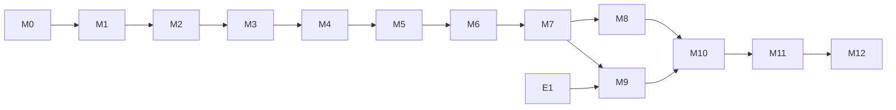

# XDCC Core Development Plan

**Status:** Phase 0 design revised after independent review. The owner authorized
M0 on 2026-10-31. Authorization does not extend to M1 or later milestones or E1.

## 1. Stages

| Stage | Milestones | Outcome |
|---|---|---|
| Foundation | M0 to M3 | Pure, fuzzed core with no I/O |
| Functional | M4 to M7 | **First functional objective:** request, negotiate, download safely, and resume, against simulated bots, for files within the 32-bit ACK range |
| Narrow evidence | E1 | Self-hosted ACK experiment that decides D9. Not a compatibility claim. |
| Hardening | M8 to M10 | Passive, large files, built-in IRC, API freeze, v0.1 candidate |
| Broad evidence | M11 | Real-world interoperability results |
| Extensions | M12 | Only if evidence justifies them |



M1 and M2 can proceed in parallel. M8 and M9 can run in parallel after M7. E1 uses a research probe rather than the library, so it does not depend on any milestone, and it can run as soon as the owner authorises it. It must finish before M9 closes.

## 2. Milestones

Every milestone's definition of done includes the following, unless stated:

- CI green on Linux, macOS, Windows: `fmt`, `clippy -D warnings`, tests, docs, `cargo deny`.
- New code has tests. No `unsafe`.
- `docs/` updated for any change in behaviour. `PROJECT_MEMORY.md` updated.
- A reviewable PR, ideally under about 500 lines of non-test code.

### M0: Repository bootstrap

**Progress, 2026-10-31:** bootstrap files implemented and checked locally on Linux
with Rust 1.88.0. CI is configured for Linux, macOS, and Windows; hosted runs and
merge have not occurred. D8 is resolved: the owner supplied
`sec.krd.hub@proton.me`, documented in root `SECURITY.md`.
See `M0_REPORT.md` for evidence.

| | |
|---|---|
| **Scope** | Rust toolchain, Cargo workspace, `xdcc-sim` stub, CI, lints, licence metadata, `CONTRIBUTING.md`, `SECURITY.md` at root |
| **Dependencies** | M0 approved by owner. D1, D2, D3 and D11 use the existing recommendations. D8 resolved with the owner-supplied private contact. Rust 1.88.0 installed in isolated temporary directories for local verification. |
| **Deliverables** | Compiling empty crates, CI workflow, `deny.toml`, `rust-toolchain.toml`, lint config denying `unsafe_code`, `unwrap_used`, `expect_used` outside tests |
| **Required tests** | A trivial test proving CI runs on all three OSes |
| **Acceptance** | `cargo test --workspace` passes in CI. `cargo deny check` passes. |
| **Risks** | MSRV conflicts between dependencies |
| **Done** | Merged. No production logic. |

### M1: Protocol codecs

| | |
|---|---|
| **Scope** | `proto`: IRC line, CTCP, DCC messages, XDCC commands, outbound builders, length budget, casemapping |
| **Dependencies** | M0 |
| **Deliverables** | Byte-based parsers and encoders. Vector file ported from `research/offer_parser_check.py`, plus cases from I1 to I6. |
| **Required tests** | Unit vectors. Property: `parse(encode(x)) == x`. Property: parser never panics. Property: corrupting one numeric field is refused and never reinterpreted. Three fuzz targets. |
| **Acceptance** | All spec vectors pass with the exact documented error. 10 million fuzz executions per target with no crash, and no input allocating over 16 KiB. Every parsing rule in `PROTOCOL_SPEC.md` §3, §4, §7 has a test. |
| **Risks** | Strict refusals costing interop with unknown senders, tracked by Q9 |
| **Done** | No I/O or Tokio in `proto`, proven by `--no-default-features` build |

### M2: Safety policies

| | |
|---|---|
| **Scope** | `policy`: `NetPolicy`, `ApprovedAddr`, filename sanitiser, limits, rate limiter |
| **Dependencies** | M0. M1 types. |
| **Deliverables** | Policy module and corpus of hostile filenames |
| **Required tests** | Table for every range in `SECURITY.md` §4. Property: sanitiser output has no separator, control, or reserved form, and is idempotent. Fuzz target. IPv4-mapped and NAT64 bypass cases. |
| **Acceptance** | `ApprovedAddr` and `SafeName` cannot be built outside `policy`, enforced by a compile-fail test. Zero bypass in corpus, which includes the CVE-2026-32733 pattern. |
| **Risks** | Over-rejection harming real names, tracked by Q11 |
| **Done** | `SECURITY.md` §4 and §5 match the code |

### M3: State machines

| | |
|---|---|
| **Scope** | `machine`: Negotiation, Data, §7.6 accounting, rule CE, gate and ledger transitions, retry classification |
| **Dependencies** | M1, M2 |
| **Deliverables** | Pure `step` functions, and a transition table test |
| **Required tests** | Exhaustive table of state × input. Proptest generating arbitrary input sequences and asserting INV-1 to INV-23. Every row of the `ARCHITECTURE.md` §7.6 edge-case table. Chunks straddling the overlap boundary. Every trigger at each §7.9 eligibility point. |
| **Acceptance** | All invariants hold across 100,000 generated sequences. `Completed` reached only by the full §7.5 path. Mutating any §7.5 check fails a test. |
| **Risks** | Timer modelling |
| **Done** | Reviewed against `ARCHITECTURE.md` §7. Any divergence fixed in docs or code. |

### M4: Simulated bot

| | |
|---|---|
| **Scope** | `xdcc-sim`: fake IRC server, scriptable bot, fault injection |
| **Dependencies** | M1 |
| **Deliverables** | Harness per §3.3, deterministic by seed |
| **Required tests** | Self-tests using a raw TCP scripted client, independent of the library's engine |
| **Acceptance** | `spec-1994` and `iroffer-like` profiles run. Same seed gives the same event trace. |
| **Risks** | Harness bugs mirroring library bugs. Mitigated by §3.3 independence rules. |
| **Done** | Each simulated behaviour cites its `PROTOCOL_SPEC.md` source |

### M5: Storage

| | |
|---|---|
| **Scope** | `store`: storage worker thread, job queue, partial, sidecar, lock, rule CE, checkpoint protocol, gate claim, ledger, finalisation, publication probe, reconciliation records, startup recovery, held-partial states |
| **Dependencies** | M2 |
| **Deliverables** | Storage API, failpoints for every CP and F step, and a platform behaviour table |
| **Required tests** | Symlink, hard link, and swapped-file attacks. Conflict policies. Disk-full simulation. Durability levels L1 and L2 (§3.7). Every row of the §7.9 and §7.10 recovery tables. Every F2 result, including an error after the operation acted. Every probe result, with lookups failed by failpoint. Every probe-result action in recovery. Every post-publication failure. Injected sync failure followed by every checkpoint trigger. A blocked job, proving task abort does not stop it. |
| **Acceptance** | All `SECURITY.md` §6 cases pass on Linux, macOS, Windows. Existing target files are never overwritten in any test. Recovery converges from every failpoint, and is idempotent. Ported L2 model passes. |
| **Risks** | `RENAME_NOREPLACE`, directory sync, and FA-1 and FA-2 in `ARCHITECTURE.md` §7.10 vary across filesystems |
| **Done** | Platform table in `ARCHITECTURE.md` §7.10 updated from test results, including which filesystems give a stable identity and which errors each returns from a lookup. Process-crash results are not described as power-loss durability. |

### M6: Active download

| | |
|---|---|
| **Scope** | `engine`, `net`, `link`: session actor, `IrcLink` channel pair, epochs, active connect, ACK writer, outcome cell, status watch, event ring, supervisor, reconciler with probe and recovery jobs, cancellation, shutdown report |
| **Dependencies** | M3, M4, M5 |
| **Deliverables** | End-to-end download against simulated bots over an `IrcLink` channel pair |
| **Required tests** | All standard scenarios in §3.3. Cancel at each state. Duplicate offers. Slow disk. All tests in §3.6. |
| **Acceptance** | SHA-256 equals the source for every run in the matrix. Cancel leaves a valid partial. No task, thread, or socket leak after 1,000 runs. A17, A18, A24, and A26 pass. |
| **Risks** | ACK and read interaction |
| **Done** | Public API draft reviewed by owner |

### M7: Resume

**This completes the first functional objective.**

| | |
|---|---|
| **Scope** | RESUME and ACCEPT, overlap verification, recovery, retry engine. Files up to 1 GiB in test. Behaviour above 4 GiB is M9. |
| **Dependencies** | M6 |
| **Deliverables** | Interrupted downloads continue, in-process and across process restart |
| **Required tests** | Disconnect at seeded byte offsets. Process kill. Changed content inside and outside the overlap. Wrong ACCEPT position. Missing ACCEPT. Partial smaller than overlap, equal to size, larger than size. Zero-length file. |
| **Acceptance** | See §4. |
| **Risks** | Retry loops |
| **Done** | §4 fully passes. Demonstrated by a recorded test run. |

### M8: Passive DCC and IPv6

| | |
|---|---|
| **Scope** | Passive offers, passive resume, listener lifecycle, IPv6 |
| **Dependencies** | M7 |
| **Deliverables** | `PassivePolicy`, `advertise` configuration, container and NAT guide |
| **Required tests** | Timeout, wrong source, second connection refused, port exhaustion, IPv6 active and passive |
| **Acceptance** | Listener never outlives its window, and accepts exactly once, in all tests. Off by default. |
| **Risks** | Real NAT behaviour is beyond simulation |
| **Done** | Guide published in `ARCHITECTURE.md` |

### M9: Large files and fault hardening

| | |
|---|---|
| **Scope** | ACK width, >4 GiB, slow-peer defences, every `hostile` scenario, retry budget, durability level L3 |
| **Dependencies** | M7. E1 results for the ACK default. |
| **Deliverables** | ACK policies, synthetic large-file generator, soak test, L3 report per tested filesystem |
| **Required tests** | 5 GiB and 17 GiB transfers. Resume across the 4 GiB boundary on both sides. Every row of the `PROTOCOL_SPEC.md` §11.3 table reproduced by `iroffer-like`. L3 on ext4 and xfs. |
| **Acceptance** | A20 to A23 in §4. Correct local result for every ACK mode. Mode-specific failures on the sim always end as resumable, never as false success. 24-hour soak with stable memory. |
| **Risks** | Simulation only reflects the model |
| **Done** | E1 results recorded, and D9 decided. Compatibility beyond E1's tested versions stays open for M11. |

### E1: Self-hosted ACK experiment

A narrow experiment, deliberately small. It decides whether the provisional ACK default stands before ACK behaviour or the public API is frozen. It is not compatibility validation, and it supports no claim beyond the exact versions tested.

| | |
|---|---|
| **Scope** | Only Q1 and Q2. Tests ACK width, first-ACK timing, and premature close above 4 GiB. |
| **Dependencies** | Owner approval of D13. Independent of the library. |
| **Setup** | Isolated local network or containers, local ircd, generated data, no third parties. iroffer-dinoex built from a pinned commit. A small research probe under `docs/research/`, acting as receiver with a selectable ACK strategy. |
| **Deliverables** | Run records, packet captures, comparison against `PROTOCOL_SPEC.md` §11.3, a written recommendation for D9 |
| **Matrix, iroffer** | 6 GiB file × fresh, resume at 1 GiB, resume at 5 GiB × 4-byte, 8-byte × initial ACK on, off × `mirc_dcc64` on, off |
| **Matrix, other senders** | HexChat, irssi, WeeChat, KVIrc as senders. 5 GiB fresh, and resume past 4 GiB, with 4-byte and 8-byte ACKs. |
| **Measures** | Does the bot close before the final ACK? Is the close FIN or RST? Does the receiver lose tail bytes? Output hash. Bot log lines. |
| **Acceptance** | Every cell is run at least 3 times and recorded with version, date, and result. Each row of §11.3 is marked confirmed or contradicted. Q2 is marked supported, refuted, or inconclusive. |
| **Risks** | Results may not generalise to other versions or configurations. A test that does not reproduce the failure leaves the hypothesis open. |
| **Done** | Owner decides D9 from the evidence. `COMPATIBILITY.md` and `PROTOCOL_SPEC.md` are updated. If results contradict the default, it changes before M9 closes. |

### M10: Built-in IRC client and API freeze

| | |
|---|---|
| **Scope** | TLS, SASL, registration, nick collision, PING, join, rejoin, STS, reconnect. API review. Docs and examples. |
| **Dependencies** | M6 to M9, and E1 with D9 decided |
| **Deliverables** | `irc-client` feature, rustdoc for all public items, v0.1.0-rc |
| **Required tests** | Fake server for each registration path. Link loss during a transfer. Certificate failure. The §3.6 link tests against the built-in pump. |
| **Acceptance** | `cargo public-api` diff reviewed. 100% of public items documented. Semver policy written. |
| **Risks** | Scope creep toward a full IRC client |
| **Done** | Owner approves API |

### M11: Real-world interoperability

Separate, evidence-based, and much broader than E1. It proves or disproves claims, and no claim precedes it.

| | |
|---|---|
| **Scope** | Tier 1, then Tier 2, in §5. Answer Q3 to Q19, and extend Q1 and Q2 beyond E1's versions. |
| **Dependencies** | M10. Owner approval of D5 and D6. |
| **Deliverables** | Evidence report per bot and version, sanitised capture corpus, updated `COMPATIBILITY.md` |
| **Required tests** | The §5 matrix |
| **Acceptance** | `COMPATIBILITY.md` lists every tested combination with version, date, and result. Each new deviation has a sim scenario. |
| **Risks** | Bans, unlawful content, unknown bot software |
| **Done** | Claims in docs match stored evidence. v0.1.0 released only after this. |

### M12: Evidence-driven extensions

Candidates: TSEND, SSEND, profile additions. Each needs evidence of real use.

## 3. Testing strategy

### 3.1 Layers

| Layer | Tool | Target |
|---|---|---|
| Unit | `cargo test` | Parsers, sanitiser, policy, framing, sidecar |
| Property | `proptest` | Round-trips, invariants, ACK reconstruction, idempotence |
| Fuzz | `cargo fuzz` | Untrusted input |
| Integration | `xdcc-sim` | End-to-end with real sockets and files |
| Narrow experiment | Research probe, real software | E1 only, ACK behaviour |
| Interop | Real software | M11 |
| Durability | Failpoints, crash-state model, block-level replay | §3.7 |
| Mutation | `cargo-mutants` | `machine`, §7.5 checks, `policy` |

### 3.2 Property tests

- `parse_dcc(encode(m)) == m` for all generated messages.
- Sanitiser: idempotent, one component, never reserved, never empty.
- `NetPolicy`: a mapped address decides the same as its plain form.
- Machine: any input sequence preserves invariants.
- ACK encoder: 4-byte value equals low 32 bits, 8-byte value equals position.
- Metamorphic: chunking data differently gives identical output and terminal state.
- Metamorphic: resuming at any offset gives the same bytes as a clean run.
- Accounting: AC-1 to AC-6 hold at every step, for any `L`, `D`, `O`, `Z`, and chunk pattern.
- ACK values strictly increase, and always exceed `P`.
- A failed overlap leaves the partial byte-identical.

### 3.3 Simulated XDCC bot

**Components.** `FakeIrcd` speaks enough IRC for registration, JOIN, PRIVMSG, NOTICE, PING, and a server-side line limit. `SimBot` is a scriptable peer. Content comes from a seeded generator, so a 17 GiB file needs no disk on the sender side, and its SHA-256 is known.

**Independence.** The sim does not import `proto` or `machine` in its wire code. It writes and parses bytes itself. Otherwise a shared bug would pass both sides. Every scenario cites its source.

```rust
// Illustrative
SimBot::new("Bot|01")
    .pack(5, Content::seeded(42, 6 * GIB), "a file.bin")
    .profile(Sim::IrofferLike)
    .on_request(Step::notice("** Sending you pack #5"))
    .then(Step::offer(Offer::active()))
    .then(Step::send_bytes(1 * GIB))
    .then(Step::reset_connection())
    .run()
```

**Standard scenarios.** Active download. Quoted name. Queue then send. Notice before offer and after offer. Missing notice. Resume, and passive resume. Zero-length files (documented as an edge case, iroffer warns on them). Multiple packs in sequence.

**Protocol deviations.**

| Group | Scenarios |
|---|---|
| CTCP | Missing final `0x01`, lowercase tag, trailing text, embedded `\x01DCC` |
| Offers | Unquoted spaces, numeric-ending names, malformed numeric tails, shifted fields, underscore substitution, Latin-1 names, oversized fields, truncation at 512 including a cut size field, duplicate offer, changed re-offer, `199` passive address, dotted IPv4, IPv6, nick change, third-party nick |
| Resume | ACCEPT with `file.ext`, rewritten name, wrong position, wrong port, wrong token, none, late, unsolicited, notice refusal at size |
| ACK | Stop-and-wait, no read, run-ahead, close before final ACK, 4-byte only, 8-byte only, iroffer detection |
| Notices | Translated, unknown, misleading `Transfer Completed` mid-transfer, wrong MD5, control characters |

**Failures.**

| Group | Scenarios |
|---|---|
| Connection | Refused, black hole, reset at seeded offsets, FIN early, RST after last byte, stall, slowloris, half-open |
| Data | More than offered, content changed on resume inside and outside the overlap, pack changed, same-length corruption with and without a digest |
| IRC | Link lost mid-transfer, kicked from channel, nick collision, bot quits, server restart |
| Local | Disk full, read-only, symlink swap, process kill, slow `fsync`, final-name conflict |
| Hostile | Traversal names, SSRF offers, offer flood, unsolicited offer, 1 MB line, malformed everything |

### 3.4 Fuzzing

Targets: `irc_line`, `ctcp`, `dcc_message`, `notice`, `sanitize_name`, `sidecar_json`, `machine_sequence`.

| Run | Duration |
|---|---|
| PR | 60 s per target |
| Nightly | 30 min per target |
| Pre-release | 8 h per target |

Crashes become permanent regression tests. Seed corpus comes from `PROTOCOL_SPEC.md` vectors, later from E1 and M11 captures.

### 3.5 CI

| Job | Trigger |
|---|---|
| fmt, clippy, tests on Linux, macOS, Windows | PR |
| MSRV build | PR |
| `cargo deny`, `cargo audit` | PR and nightly |
| Miri on pure modules | Nightly |
| Sanitizers, fuzz, soak-lite | Nightly |
| 5 GiB transfer, from M9 | Nightly |
| Durability L2 | PR |
| Durability L3 on ext4 and xfs, from M9 | Nightly or pre-release, on a privileged runner |
| `cargo-mutants` on critical modules | Weekly |

### 3.6 Outcome and link tests

These run with **no event consumer** unless a test says otherwise.

| ID | Test |
|---|---|
| OT-1 | `wait()` returns `Completed` with `events()` never called |
| OT-2 | 100,000 events with no subscriber: transfer speed and memory are unaffected |
| OT-3 | Subscriber that never polls: `wait()`, `cancel()`, and cleanup all finish |
| OT-4 | Ring overflow: the subscriber gets `Lagged { missed }` with the right count, then continues |
| OT-5 | Lagging subscriber still receives `Finished` exactly once |
| OT-6 | Two subscribers, one stalled: the other receives everything in order |
| OT-7 | Subscriber dropped mid-transfer: no effect |
| OT-8 | Subscriber joins after the terminal commit: `Snapshot`, `Finished`, end |
| OT-9 | `cancel()` in every state, ring full, within 2 s |
| OT-10 | `shutdown` with stalled subscribers finishes within its deadline. Every `wait()` resolves, except transfers listed as unresolved, each with an owner. |
| OT-11 | Panic injected in a transfer task: `wait()` resolves `Failed(Internal)` |
| OT-12 | `ResumePolicy::Ask` with no decision: `ResumeDecisionTimeout` |
| OT-13 | Concurrent `wait()` from 100 tasks gives the same outcome |
| OT-14 | Finished-outcome registry stays bounded, and held handles stay valid after eviction |
| OT-15 | Deadline at each finalisation failpoint: outcome matches the file on disk |
| OT-16 | F2 blocked at a failpoint, task aborted, deadline passes: no outcome, listed as unresolved. On release, the worker commits exactly once. |
| OT-17 | `cancel()` racing the gate claim 10,000 times: `Accepted` always gives `Cancelled` with nothing published. `TooLate` never does. |
| OT-18 | `cancel_and_discard()` at each failpoint: a published file is never deleted |
| OT-19 | Worker panic at each finalisation failpoint, with lookups working: the outcome matches the file on disk |
| OT-20 | Aborted task with a checkpoint in flight: a second transfer gets `Held(Busy)` until it finishes |
| OT-21 | Runtime dropped with a worker running: the drop does not hang, and recovery converges |
| OT-22 | F2 acts, returns an error, and every lookup fails: no outcome, `wait()` pending, `unresolved()` set, no `Finished`. When lookups recover: `Completed` exactly once. |
| OT-23 | F2 has no effect, returns an error, and every lookup fails: as OT-22, then `Failed` exactly once, with nothing published |
| OT-24 | Every probe input, including each single failed lookup, gives the same classification at the worker, the reconciler, and recovery |
| OT-25 | Worker panic at each ledger stage with lookups failing: `Claimed`, `IntentDurable`, and `Published` commit from the ledger with no probe. `PublishInFlight` stays unresolved. |
| OT-26 | Shutdown with an unknown publication, and with a worker returning `Indeterminate` after shutdown: listed with its owner, handles and lock released, stream ends with no `Finished`. On restart: `Held(PublicationUnknown)`, with no file changed. |
| OT-27 | While unknown, try `cancel_and_discard()`, a new request, `resume`, and `RestartFromZero`: `TooLate` or `Held(Busy)`, and every file is byte-identical |
| OT-28 | Filesystem never readable: 8 attempts on one thread, then dormant. A hung probe adds no thread. Repeated `reconcile_unresolved()` gives one attempt. The record keeps its slot. |
| OT-29 | Probe jobs, on every probe result with write attempts traced: no file name, partial, or sidecar changes, and no conflict policy runs |
| OT-30 | Recovery job on every §7.10 row, with each lookup failed by failpoint and with the lock held elsewhere: only rows 1 to 3 change files, only on lookups that worked in that job. Repeated F2 ending `Indeterminate` stops before F3. Busy changes nothing. Nothing is retried without a host call. |
| OT-31 | Shutdown with recovery jobs queued and one running, stopped at each stop check and blocked inside F2: queue dropped, no step begins after stop, the running job is in `recovery_busy`, and the next recovery converges |
| LT-1 | Pending inbound read while lines are sent |
| LT-2 | Outbound full with no reader: inbound keeps draining, and other transfers keep receiving |
| LT-3 | `OutboundRx::recv` cancelled in `select!` 10,000 times: no line lost |
| LT-4 | Session send cancelled mid-`reserve`: no line lost or duplicated |
| LT-5 | FIFO preserved in each direction under load |
| LT-6 | `try_deliver` returns `Full` and the line is lost: timers fire, no false state |
| LT-7 | Stale-epoch item is discarded, and `XDCC SEND` does not cross reconnects |
| LT-8 | `Down` during negotiation fails with `LinkLost`. `Down` during `Data` lets the transfer finish. |
| LT-9 | All senders dropped: new requests fail, active transfers finish |
| LT-10 | `XDCC CANCEL` with a full outbound queue: cancel still finishes |

### 3.7 Durability testing

Process-crash tests and power-loss tests prove different things, and results must never be reported as each other.

| Level | Method | Proves | Does not prove | Where |
|---|---|---|---|---|
| L1 Process crash | Kill the process at a failpoint at every CP and F step, then recover | Recovery logic and step ordering. The OS page cache survives, so unsynced data still looks durable. | Anything about power loss | M5, M7. All OSes. |
| L2 Crash-state, shutdown, and probe models | Port `research/durability_model.py`: enumerate states allowed by a stated filesystem model, and interleavings of the worker with shutdown and reconciliation, with lookups that can fail | The protocol is safe under those models | That any real filesystem or runtime matches them | M5. CI. |
| L3 Block-level replay | [dm-log-writes](https://www.kernel.org/doc/html/latest/admin-guide/device-mapper/log-writes.html) in a privileged VM: replay the log to chosen points, mount, run recovery, check | Behaviour of a specific kernel and filesystem under write loss at flush boundaries | Other filesystems, or devices that ignore flushes | M9. ext4 and xfs on Linux. |
| L4 Physical power cut | Not planned | n/a | n/a | Owner decision D15 |

Durability claims name the filesystem, kernel, and level. macOS and Windows have L1 only, so their documentation says process-crash tested and makes no power-loss claim.

The models establish logic only. An in-flight publication needs L1-style tests on real files (OT-16), and a failed lookup needs tests on real errors (OT-22 to OT-26). These exist from M5 and M6. Injected lookup failures show how the library reacts, and say nothing about which errors a real filesystem returns.

## 4. Acceptance criteria: first functional objective

All must pass at M7 against `spec-1994` and `iroffer-like` simulated bots, except where a later milestone is named. These are **simulated** results. They support no real-world compatibility claim.

**Reading these criteria.** `ARCHITECTURE.md` §7.5 defines three levels. Structural guarantees hold for every `Completed`. Content integrity exists only against a trusted digest. Same-length corruption under `SizeOnly` is undetectable by design, so it is measured as expected behaviour, never as a failure.

In A1 to A3 the harness computes SHA-256 independently, and injects no corruption. These prove the data path is correct, and they do not mean the library verified content.

| ID | Criterion | Measure | Milestone |
|---|---|---|---|
| A1 | Clean download | 1,000 runs, sizes 0 B to 256 MiB. Harness SHA-256 matches in 100%. | M7 |
| A2 | Resume | 1,000 seeded disconnects at random offsets. After resume, harness SHA-256 matches in 100%. | M7 |
| A3 | Process-crash recovery | 200 process kills at random points and at every failpoint, then resume. Harness SHA-256 matches in 100%. Durability level L1 only. | M7 |
| A4a | Structural completion | 10,000 fault-injected runs at every integrity level. Count of `Completed` with wrong length, an unpublished or partial file, or an overrun accepted is **0**. | M7 |
| A4b | Trusted digest | 1,000 runs with same-length corruption or substitution, each with `expected_sha256`. 100% end as `HashMismatch`, and **0** as `Completed`. Clean runs report `Sha256HostSupplied`. | M7 |
| A4c | `SizeOnly` boundary | 100 same-length corruption runs with no digest. Each is **expected** to end `Completed { integrity: SizeOnly }`. The test asserts that level, so the limit stays visible. | M7 |
| A5 | No overwrite | Pre-existing target content is unchanged in 100% of conflict tests | M7 |
| A6 | Containment | Traversal corpus: 0 writes outside the download directory | M7 |
| A7 | SSRF | 100% of `SECURITY.md` §4 destinations refused, with 0 connection attempts, measured at a listener | M7 |
| A8 | Unsolicited | 0 connections or files from unmatched offers | M7 |
| A9 | Changed content on resume | Change inside the overlap: 100% `ResumeMismatch`, partial byte-identical. Change outside the overlap with a trusted digest: 100% `HashMismatch`. Change outside the overlap with no digest: expected `Completed { integrity: SizeOnly }`, as in A4c. | M7 |
| A10 | Cancel | Cancel in every state before the gate claim yields `Cancelled`, a usable partial, and no leaked task, within 2 s plus any running storage job, with no event consumer. After the claim it returns `TooLate`. | M7 |
| A11 | Robustness | No panic in the `hostile` scenarios available at M7. Fuzzing clean per M1. | M7 |
| A12 | Boundedness | Peak memory under 64 MiB per transfer, for a 1 GiB transfer | M7 |
| A13 | Determinism | Same seed gives the same outcome across 100 repeats | M7 |
| A14 | Diagnostics | Every failure gives a specific `ErrorKind`, verified per scenario | M7 |
| A15 | Coverage | 90% line coverage in `proto`, `policy`, `machine`, and `store` | M7 |
| A16 | Accounting | Every row of the `ARCHITECTURE.md` §7.6 edge-case table passes end to end | M7 |
| A17 | Observer independence | OT-1 to OT-14 pass | M6 |
| A18 | Link contract | LT-1 to LT-10 pass | M6 |
| A19 | Crash-state model | L2 passes with zero unsafe states | M5 |
| A20 | Large-file data path | 5 GiB and 17 GiB transfers, and resume across 4 GiB. Harness SHA-256 matches in 100%. | M9 |
| A21 | Large-file boundedness | Peak memory under 64 MiB per transfer, for a 5 GiB transfer | M9 |
| A22 | ACK modes | Every §11.3 row reproduced in `iroffer-like`. Local outcome correct in each. | M9 |
| A23 | Power-loss replay | L3 on ext4 and xfs: recovery converges at every replay point, and `durable_offset` never exceeds valid data | M9 |
| A24 | Truthful outcomes | OT-15 to OT-21 pass. `Cancelled` with a published file, `Completed` without one, and two commits for a transfer each occur **0** times. | M6 |
| A25 | Checkpoint eligibility | Every trigger at every §7.9 eligibility point. Across 10,000 randomised runs, `D` never decreases, and never covers unverified bytes. | M5 |
| A26 | Uncertainty preserved | OT-22 to OT-31 pass. On tested local filesystems, `Failed` with the file published, and any publish, cleanup, or delete while publication is unknown, each occur **0** times. | M6 |

A1 to A16 need no file above 1 GiB, and none depends on ACK width above 32 bits.

v0.1.0 additionally needs M8 to M11, E1, and A1 to A8 with the `hostile`, `mirc-like`, `hexchat-like`, and `irssi-like` profiles.

## 5. Interoperability plan (M11)

No compatibility claim is made until this has run, and claims cover only what was tested. E1 comes first and covers ACK behaviour only. Vendor documentation and simulated passes never count as compatibility evidence.

### Tier 1: self-hosted, no third parties

A private network with a local ircd. Use software-generated content or freely licensed test files.

| Sender | Modes |
|---|---|
| iroffer-dinoex current release | Active, passive, `mirc_dcc64` on and off, resume, 5 GiB, queue, IPv6 |
| HexChat, irssi, WeeChat, KVIrc as senders | Active, passive, resume, 5 GiB |
| mIRC, subject to D6 | Active, passive, resume, 5 GiB |

Capture traffic with `tcpdump`, keep logs, and hash each output. This answers Q7 and Q8, and extends E1's answers to Q1 and Q2 with the finished library, with no public impact.

### Tier 2: public networks, only if approved

Requires D5. Conditions:

- Only material you have the right to download.
- Follow network and channel rules.
- Rate-limited, identified honestly, retries off, small files first.
- Any capture is sanitised before it enters the repository: nicks, hosts, IPs, and filenames.

### Evidence record

Each result includes date, library commit, bot name and version, network type, mode, size, ACK width, outcome, and hash match.

## 6. Top project risks

| Risk | Mitigation |
|---|---|
| No specification. Behaviour is whatever deployed bots do. | Evidence tags, M11, profile data |
| Simulation mirrors assumptions | Independent sim, E1 before the API freeze, real iroffer in Tier 1 |
| Scope growth into a full IRC client | Non-goals, `IrcLink` channels as the primary boundary |
| Durability overclaimed from process-crash tests | Separate levels in §3.7, claims name the filesystem and level |
| ACK width has no universally safe value | Provisional default, E1, local completion proof, resumable failure |
| Project association with piracy | Neutral docs. Legitimate test content. Owner-led policy. |
| Library licence limits adoption | D1 |
